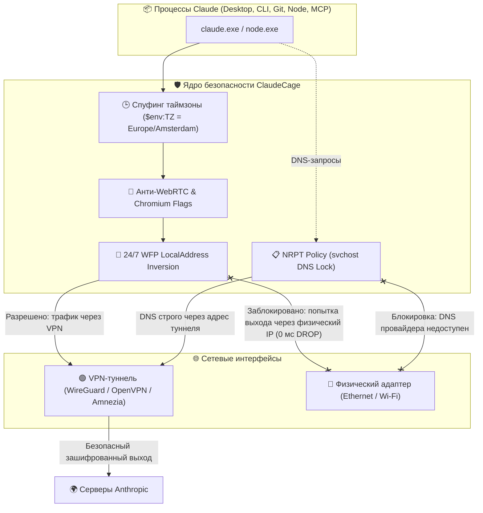

# 🏛️ Архитектура ClaudeCage: Внутреннее устройство и механизмы защиты

Документ описывает техническую архитектуру, модель угроз и алгоритмы изоляции **Claude Desktop** и **Claude Code (CLI)** на базе ядра **Windows Filtering Platform (WFP)**.

---

## 🚀 1. Как устроен ClaudeCage и почему это круто

Внутри ClaudeCage реализована многоуровневая эшелонированная оборона на уровне ядра операционной системы:

---

## 🔍 2. Разбор уровней защиты: Что сделано и почему это работает

### Уровень 1: Аппаратный замок 0 мс (LocalAddress Inversion)
* **Проблема обычных решений:** Когда VPN выключается, сетевой стек Windows мгновенно перенаправляет активные соединения на шлюз по умолчанию (домашний Ethernet или Wi-Fi). Традиционные kill switch скрипты отслеживают статус адаптера с интервалом в 1–3 секунды — в это окно успевает улететь пачка пакетов с реального IP.
* **Что мы сделали:** Применили **инверсию исходного IP-адреса (`LocalAddress`)** в Windows Filtering Platform:
  - Исходящий трафик для Claude **заблокирован для всех адресов в мире**, кроме подсети VPN-туннеля и локального интерфейса (`127.0.0.1` для MCP-серверов).
* **Почему это круто:** Правило висит в фаерволе Windows **24/7 в статическом режиме**. При падении VPN сокет физически не может привязаться к домашнему IP `192.168.x.x` — ядро WFP уничтожает такой сокет мгновенно (**за 0 миллисекунд**), без необходимости запуска каких-либо скриптов.

---

### Уровень 2: Замок на уровне системного DNS (NRPT)
* **Проблема обычных решений:** Приложения на Windows часто обращаются к функции `getaddrinfo()`. Этот запрос передается по межпроцессному RPC в системный процесс `svchost.exe -k NetworkService` (службу DNS Client). Даже если приложение заблокировано в фаерволе, сам `svchost.exe` отправляет DNS-запрос к провайдеру РФ, раскрывая домены `api.anthropic.com`.
* **Что мы сделали:** Внедрили правила **NRPT (Name Resolution Policy Table)** через командлет `Add-DnsClientNrptRule`.
* **Почему это круто:** На уровне самого ядра DNS-клиента Windows все домены Anthropic (`.anthropic.com`, `.claude.ai`, `.claude.com`, `.sentry.io`, `.stripe.com`, `.intercom.io`) принудительно замкнуты на внутренний DNS-сервер туннеля. Если VPN выключен, `svchost.exe` возвращает отказ и **никогда не пересылает запрос к провайдерскому DNS**.

---

### Уровень 3: Антифрод-стелс (Electron & Node.js)
* **Проблема обычных решений:** Антифрод-системы Cloudflare Turnstile и Datadome сверяют геолокацию IP-адреса и системные часы браузера. Если IP из Нидерландов, а в объекте `Intl.DateTimeFormat()` светится таймзона `Europe/Moscow (+03:00)`, сессия моментально попадает под подозрение или бан.
* **Что мы сделали:**
  - Лаунчер динамически инжектирует `$env:TZ = $vpnTimezone` (например, `Europe/Amsterdam`). Движок V8 в Electron и Node.js рапортует точное местное время VPN-сервера.
  - Принудительно завершаются фоновые процессы Claude в трее перед новым запуском, исключая активацию старого процесса с московским временем.
  - Добавлены жесткие флаги Chromium: `--force-webrtc-ip-handling-policy=disable_non_proxied_udp`, блокирующие утечку локального IP через WebRTC STUN/ICE.
  - Запрещен доступ к датчикам геолокации Windows (`ConsentStore\location\NonPackaged` -> `Deny`).

---

### Уровень 4: Защита дочерних процессов и MCP-серверов
* **Проблема обычных решений:** Claude Desktop и Claude Code спавнят дочерние процессы (например, `git clone / git push` вызывает `git-remote-https.exe`, а плагины MCP запускают локальные скрипты). Если правило фаервола закрывает только `claude.exe`, дочерний процесс выходит в сеть напрямую.
* **Что мы сделали:**
  - В правила WFP автоматически включаются все сетевые бинарники Git (`git.exe`, `git-remote-https.exe`, `git-remote-http.exe`, `ssh.exe`).
  - Парсится файл конфигурации `%APPDATA%\Claude\claude_desktop_config.json` и автоматически защищаются все исполняемые файлы MCP-серверов.
  - Изолированные копии `node.exe` и `curl.exe` вынесены в `C:\ClaudeCage\bin\`.

---

### Уровень 5: Атомарное обновление (Make-Before-Break)
* **Что мы сделали:** Любое обновление правил фаервола выполняется строго по схеме **Make-Before-Break**. Новые правила сначала полностью генерируются с уникальным ID поколения (`Gen...`), и только после их активации в памяти ядра Windows удаляются устаревшие правила.
* **Почему это круто:** Окно гонки состояний (TOCTOU) сведено к абсолютному нулю.

---

## 🌐 3. Универсальность: Поддержка любого VPN

Система спроектирована с приоритетом для **AmneziaVPN**, но поддерживает **любой VPN-клиент на Windows 11**:

1. **AmneziaVPN (Приоритет):** если запущен клиент Amnezia, клетка использует его WireGuard-адаптер, подсеть CGNAT (`100.64.0.0/10`) и шлюз DNS `100.64.0.1`.
2. **Другие VPN (WireGuard, OpenVPN, Tailscale, Proton, Mullvad и др.):**
   - Алгоритм автоматически обнаруживает виртуальный интерфейс туннеля (по типу `PropVirtual / Tunnel`, описанию адаптера или активному шлюзу по умолчанию).
   - Считывает назначенный виртуальный IP-адрес и DNS-серверы туннеля.
   - Адаптирует правила WFP и NRPT под конкретный VPN без необходимости менять код вручную.
3. **Офлайн-статус:** если при запуске VPN еще не поднят, система безопасно активирует превентивный режим изоляции, запрещая выход в сеть до появления защищенного туннеля.
