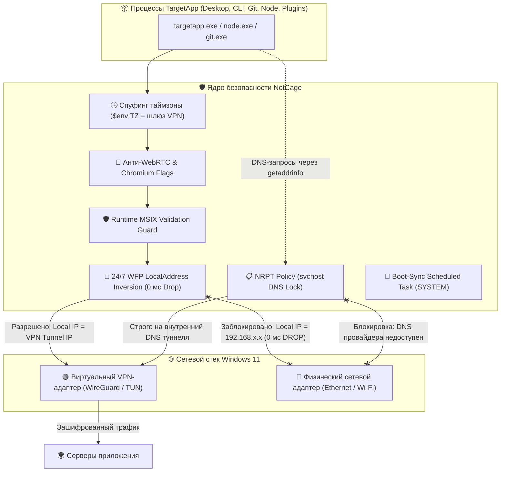

# Промпт для аудита архитектуры сетевой изоляции и предотвращения утечек данных (Windows 11)

> **Инструкция для пользователя:** Скопируйте весь текст ниже (начиная с разделителя `=== НАЧАЛО ЗАПРОСА ДЛЯ АУДИТА ===`) и отправьте в диалог с Claude Sonnet. В тексте полностью удалены любые упоминания Anthropic и Claude. Проект подан в контексте строгой корпоративной безопасности (Zero-Trust DLP & Geo-Compliance Sandbox).

---

```markdown
=== НАЧАЛО ЗАПРОСА ДЛЯ АУДИТА ===

Ты выступаешь в роли ведущего эксперта по кибербезопасности, низкоуровневой сетевой архитектуре Windows (Windows Filtering Platform / WFP, NDIS, TCP/IP стек) и реверс-инжинирингу сред исполнения Chromium/Electron и Node.js.

Я прошу тебя провести глубокий архитектурный и программный аудит разработанной системы изоляции сетевого трафика на **Windows 11 (x64)** под кодовым названием **NetCage**.

---

### 🎯 1. Целевая задача и модель угроз (Requirements & Threat Model)

На рабочей станции Windows 11 развернуто проприетарное клиентское ПО (**TargetApp**), состоящее из двух компонентов:
1. **TargetApp Desktop** — графическое приложение на базе **Electron / Chromium (распространяется как MSIX / AppX пакет Windows Store)**.
2. **TargetApp CLI** — консольная утилита командной строки на базе **Node.js (V8 runtime)**, вызывающая дочерние процессы (Git, SSH, локальные IPC/RPC сервисы).

#### Ключевые требования:
1. **Строгий Fail-Closed режим через VPN:**
   Приложение (как Desktop, так и CLI) должно иметь физическую возможность обмениваться сетевыми пакетами **строго и исключительно через активный VPN-туннель** (WireGuard / OpenVPN, подсеть туннеля, например `100.64.0.0/10` или `10.0.0.0/8`).
2. **Нулевая толерантность к утечкам реального IP (0 ms Drop):**
   Если VPN-соединение внезапно обрывается, отключается пользователем или находится в процессе реконнекта, приложение должно **мгновенно (за 0 миллисекунд)** полностью терять доступ к сети. Не должно быть даже микросекундного окна гонки состояний (TOCTOU), когда сокет успел бы перебиндиться на шлюз домашнего провайдера (Wi-Fi или Ethernet, например `192.168.0.x`). Для приложения это должно выглядеть как полное отключение физического сетевого кабеля («No internet connection»).
3. **Полная прозрачность и защита от анализа окружения:**
   Удаленный бэкенд приложения не должен выявлять аномалий:
   - Должна исключаться рассинхронизация системных часов (IP европейского шлюза VPN, а системный `Intl.DateTimeFormat()` рапортует локальную таймзону хоста).
   - WebRTC не должен собирать локальные IP-кандидаты хоста (`192.168.x.x`).
   - Запросы системного DNS через `svchost.exe (Dnscache)` не должны отправляться домашнему провайдеру.
   - Фоновые процессы приложения, оставшиеся в трее до включения VPN, не должны продолжать работу со старыми сетевыми контекстами.
4. **Устойчивость к автообновлениям MSIX Windows Store:**
   MSIX-пакеты обновляются в фоне, меняя путь установки на `C:\Program Files\WindowsApps\TargetApp_<new_version>_\app\targetapp.exe`. Система должна автоматически и безопасно обрабатывать этот сценарий.

---

### 🏛️ 2. Разработанная архитектура NetCage

В системе реализована эшелонированная оборона на 7 уровнях:



#### Механизмы реализации:
1. **24/7 WFP LocalAddress Inversion (Мастер-замок 0 мс):**
   Вместо динамического навешивания правил при падении VPN в фаерволе Windows 24/7 перманентно висят правила с инверсией локального IP-адреса источника (`LocalAddress`):
   - Заблокированы диапазоны: `0.0.0.0-100.63.255.255`, `100.128.0.0-126.255.255.255`, `128.0.0.0-255.255.255.255`.
   - Разрешены только: локальный `127.0.0.1` (для IPC) и CGNAT подсеть туннеля `100.64.0.0/10` (либо `10.0.0.0/8`).
   - Если VPN рвется, ОС пытается привязать сокет к `192.168.x.x` — пакет моментально дропается драйвером WFP на уровне ядра без задержек.
2. **Атомарный Make-Before-Break:**
   При обновлении конфигурации новые правила сначала полностью разворачиваются с поколением `Gen<timestamp>`, и только затем удаляются устаревшие правила.
3. **Защита системного DNS через NRPT (Name Resolution Policy Table):**
   Для всех доменов сервиса через `Add-DnsClientNrptRule` прописано жесткое правило: опрашивать только внутренний DNS туннеля (например, `100.64.0.1`). Даже если `svchost.exe -k NetworkService` пытается резолвить домен, он не пойдет к провайдеру хоста. Также глобально отключены SMHNR (`DisableSmartNameResolution = 1`) и LLMNR.
4. **Покрытие MSIX PackageFamilyName + Binary Paths:**
   Правила создаются как для `PackageFamilyName`, так и для всех обнаруженных бинарников в `WindowsApps`, а также для связанных утилит Git (`git.exe`, `git-remote-https.exe`, `ssh.exe`) и плагинов.
5. **Runtime MSIX Guard с авто-эскалацией UAC:**
   Лаунчер проверяет, входит ли фактический бинарник в активные фильтры WFP. Если произошло тихое обновление Store, вызывается разовый UAC для пересинхронизации, а если UAC отклонен — выполнение немедленно прерывается (`exit 1` Fail-Closed).
6. **Системный планировщик задач (`NetCage-BootSync`):**
   При старте Windows и входе пользователя (`AtStartup` + `AtLogOn`) задание с правами `NT AUTHORITY\SYSTEM` в фоновом режиме актуализирует правила в WFP.

---

### 💻 3. Исходный код ключевых компонентов системы

Ниже приведен полный исходный код основных модулей системы для проверки:

#### Модуль 1: `Sync-AppFirewall.ps1` (Ядро синхронизации WFP)
```powershell
[CmdletBinding()]
param(
    [switch]$Enforce,
    [switch]$Remove,
    [switch]$Status
)

$ErrorActionPreference = 'Stop'

$CageRoot  = "C:\NetCage"
$CageBin   = Join-Path $CageRoot "bin"
$GroupName = "NetCageKillSwitch"

function Get-ActiveVpnAdapter {
    $vpn = Get-NetAdapter | Where-Object {
        $_.Status -eq "Up" -and (
            $_.InterfaceDescription -match "WireGuard|Wintun|TUN|TAP|OpenVPN|Tailscale|VPN|CorporateVPN" -or
            $_.Name -match "VPN|WireGuard|Tailscale|TUN|TAP|CorporateVPN" -or
            $_.InterfaceType -in @(23, 53, 131)
        )
    } | Select-Object -First 1
    if ($vpn) { return $vpn }

    $defRoute = Get-NetRoute -DestinationPrefix "0.0.0.0/0" -ErrorAction SilentlyContinue | Sort-Object RouteMetric | Select-Object -First 1
    if ($defRoute) {
        $cand = Get-NetAdapter -InterfaceIndex $defRoute.InterfaceIndex -ErrorAction SilentlyContinue
        if ($cand -and $cand.Virtual -and $cand.InterfaceDescription -notmatch "Hyper-V|VirtualBox|VMware|WSL") {
            return $cand
        }
    }
    return $null
}

function Get-CageTargetBinaries {
    $targets = [System.Collections.Generic.List[PSCustomObject]]::new()

    function Add-TargetBinary ($Name, $Path) {
        if (Test-Path $Path) {
            $targets.Add([PSCustomObject]@{
                Name              = $Name
                Type              = "Binary"
                Path              = $Path
                PackageFamilyName = $null
            })
        }
    }

    # 1. Изолированные копии Node и Curl
    Add-TargetBinary "Sandboxed-Node" (Join-Path $CageBin "node.exe")
    Add-TargetBinary "Sandboxed-Curl" (Join-Path $CageBin "curl.exe")

    # 2. CLI бинарник
    $cliCandidates = @(
        "$env:APPDATA\npm\node_modules\@target-app\cli\bin\targetapp.exe",
        "$env:LOCALAPPDATA\npm\node_modules\@target-app\cli\bin\targetapp.exe",
        "$env:USERPROFILE\AppData\Roaming\npm\node_modules\@target-app\cli\bin\targetapp.exe"
    )
    foreach ($cand in $cliCandidates) {
        if (Test-Path $cand) {
            Add-TargetBinary "TargetApp-CLI" $cand
            break
        }
    }

    # 3. MSIX Package Family & Binary
    $appx = Get-AppxPackage -Name *TargetApp* -ErrorAction SilentlyContinue | Select-Object -First 1
    if ($appx) {
        $targets.Add([PSCustomObject]@{
            Name              = "TargetApp-Desktop-MSIX"
            Type              = "PackageFamily"
            Path              = $null
            PackageFamilyName = $appx.PackageFamilyName
        })
        $appxExe = Join-Path $appx.InstallLocation "app\targetapp.exe"
        Add-TargetBinary "TargetApp-Desktop-AppX-Exe" $appxExe
    }

    # Поиск версий в WindowsApps
    $windowsAppsDirs = Get-ChildItem -Path "C:\Program Files\WindowsApps" -Filter "*TargetApp*" -Directory -ErrorAction SilentlyContinue
    $idx = 0
    foreach ($dir in $windowsAppsDirs) {
        $appPath = Join-Path $dir.FullName "app\targetapp.exe"
        if (Test-Path $appPath) {
            Add-TargetBinary "TargetApp-Desktop-WindowsApps-$idx" $appPath
            $idx++
        }
    }

    # 4. Бинарники Git
    $gitPaths = @(
        "C:\Program Files\Git\cmd\git.exe",
        "C:\Program Files\Git\mingw64\bin\git.exe",
        "C:\Program Files\Git\mingw64\libexec\git-core\git-remote-https.exe",
        "C:\Program Files\Git\mingw64\libexec\git-core\git-remote-http.exe",
        "C:\Program Files\Git\usr\bin\ssh.exe"
    )
    foreach ($gp in $gitPaths) {
        if (Test-Path $gp) {
            $bName = [System.IO.Path]::GetFileNameWithoutExtension($gp)
            Add-TargetBinary "Git-$bName" $gp
        }
    }

    return $targets
}

# --- ENFORCE KILL SWITCH RULES (ATOMIC MAKE-BEFORE-BREAK) ---
$targets = Get-CageTargetBinaries
$vpnAdapter = Get-ActiveVpnAdapter
$vpnIp = if ($vpnAdapter) { (Get-NetIPAddress -InterfaceIndex $vpnAdapter.InterfaceIndex -AddressFamily IPv4 -ErrorAction SilentlyContinue).IPAddress } else { $null }

$nonVpnAdapters = Get-NetAdapter | Where-Object {
    if ($vpnAdapter) { $_.InterfaceIndex -ne $vpnAdapter.InterfaceIndex } else { $_.Virtual -ne $true }
}
$nonVpnAliases = @($nonVpnAdapters | ForEach-Object { $_.Name })

# LocalAddress Inversion
$blockedLocalIpRanges = @(
    "0.0.0.0-100.63.255.255",
    "100.128.0.0-126.255.255.255",
    "128.0.0.0-255.255.255.255"
)
if ($vpnIp -and $vpnIp -like "10.*") {
    $blockedLocalIpRanges = @(
        "0.0.0.0-9.255.255.255",
        "11.0.0.0-126.255.255.255",
        "128.0.0.0-255.255.255.255"
    )
}

$blockedLanRanges = @("192.168.0.0/16", "172.16.0.0/12", "169.254.0.0/16", "224.0.0.0/4")
$blockedIpv6Remote = @("2000::/3", "fc00::/7", "fe80::/10")
$blockedIpv6Local  = @("0000::-0000:ffff:ffff:ffff:ffff:ffff:ffff:fffe", "0001::-ffff:ffff:ffff:ffff:ffff:ffff:ffff:ffff")

$oldRules = Get-NetFirewallRule | Where-Object { $_.Group -eq $GroupName -or $_.Name -like "NetCage*" }
$genTag = "Gen" + [DateTime]::UtcNow.ToString("yyyyMMddHHmmss")
$newRuleNames = [System.Collections.Generic.List[string]]::new()

$targetIndex = 0
foreach ($t in $targets) {
    $targetIndex++
    $safeName = "$targetIndex-" + ($t.Name -replace '[^a-zA-Z0-9_\-]', '')

    # ПРАВИЛО 1: LocalAddress Inversion (0 ms Lock)
    $r1Name = "NetCage-$genTag-LocalInv-$safeName"
    $r1Display = "NetCage: Block Non-VPN Source IP for $($t.Name)"
    if ($t.Type -eq "PackageFamily") {
        New-NetFirewallRule -Name $r1Name -DisplayName $r1Display -Group $GroupName `
            -Direction Outbound -Action Block -PackageFamilyName $t.PackageFamilyName `
            -LocalAddress $blockedLocalIpRanges -Enabled True | Out-Null
    } else {
        New-NetFirewallRule -Name $r1Name -DisplayName $r1Display -Group $GroupName `
            -Direction Outbound -Action Block -Program $t.Path `
            -LocalAddress $blockedLocalIpRanges -Enabled True | Out-Null
    }
    $newRuleNames.Add($r1Name)

    # ПРАВИЛО 2: Блокировка физических интерфейсов
    if ($nonVpnAliases.Count -gt 0) {
        $r2Name = "NetCage-$genTag-Adapter-$safeName"
        $r2Display = "NetCage: Block Physical Adapters for $($t.Name)"
        if ($t.Type -eq "PackageFamily") {
            New-NetFirewallRule -Name $r2Name -DisplayName $r2Display -Group $GroupName `
                -Direction Outbound -Action Block -PackageFamilyName $t.PackageFamilyName `
                -InterfaceAlias $nonVpnAliases -Enabled True | Out-Null
        } else {
            New-NetFirewallRule -Name $r2Name -DisplayName $r2Display -Group $GroupName `
                -Direction Outbound -Action Block -Program $t.Path `
                -InterfaceAlias $nonVpnAliases -Enabled True | Out-Null
        }
        $newRuleNames.Add($r2Name)
    }

    # ПРАВИЛО 3: Блокировка LAN & STUN
    $r3Name = "NetCage-$genTag-Lan-$safeName"
    $r3Display = "NetCage: Block LAN/STUN for $($t.Name)"
    if ($t.Type -eq "PackageFamily") {
        New-NetFirewallRule -Name $r3Name -DisplayName $r3Display -Group $GroupName `
            -Direction Outbound -Action Block -PackageFamilyName $t.PackageFamilyName `
            -RemoteAddress $blockedLanRanges -Enabled True | Out-Null
    } else {
        New-NetFirewallRule -Name $r3Name -DisplayName $r3Display -Group $GroupName `
            -Direction Outbound -Action Block -Program $t.Path `
            -RemoteAddress $blockedLanRanges -Enabled True | Out-Null
    }
    $newRuleNames.Add($r3Name)

    # ПРАВИЛО 4: Блокировка IPv6
    $r4Name = "NetCage-$genTag-IPv6-$safeName"
    $r4Display = "NetCage: Block IPv6 for $($t.Name)"
    if ($t.Type -eq "PackageFamily") {
        New-NetFirewallRule -Name $r4Name -DisplayName $r4Display -Group $GroupName `
            -Direction Outbound -Action Block -PackageFamilyName $t.PackageFamilyName `
            -RemoteAddress $blockedIpv6Remote -LocalAddress $blockedIpv6Local -Enabled True | Out-Null
    } else {
        New-NetFirewallRule -Name $r4Name -DisplayName $r4Display -Group $GroupName `
            -Direction Outbound -Action Block -Program $t.Path `
            -RemoteAddress $blockedIpv6Remote -LocalAddress $blockedIpv6Local -Enabled True | Out-Null
    }
    $newRuleNames.Add($r4Name)
}

# Атомарное удаление старых правил (Make-Before-Break)
if ($oldRules) {
    $oldRules | Where-Object { $newRuleNames -notcontains $_.Name } | Remove-NetFirewallRule
}
```

---

#### Модуль 2: `Set-DnsHardening.ps1` (Защита системного DNS)
```powershell
# Привязка доменов сервиса строго к DNS туннеля через NRPT
$targetDomains = @(
    ".targetapp-backend.com",
    ".targetapp.io",
    ".targetapp-auth.com",
    ".telemetry-service.io",
    ".billing-gateway.com"
)
$tunnelDns = "100.64.0.1"

# Сброс старых правил
Get-DnsClientNrptRule -ErrorAction SilentlyContinue | Where-Object { $_.Comment -eq "NetCageNRPT" } | Remove-DnsClientNrptRule -Force

# Установка новой политики
Add-DnsClientNrptRule -Namespace $targetDomains -Nameserver $tunnelDns -Comment "NetCageNRPT"

# Отключение SMHNR (Smart Multi-Homed Name Resolution)
Set-ItemProperty -Path "HKLM:\SOFTWARE\Policies\Microsoft\Windows NT\DNSClient" -Name "DisableSmartNameResolution" -Value 1 -Type DWord
Set-ItemProperty -Path "HKLM:\SOFTWARE\Policies\Microsoft\Windows NT\DNSClient" -Name "EnableMulticast" -Value 0 -Type DWord

# RFC 3484 IPv4 Preference (0x20)
Set-ItemProperty -Path "HKLM:\SYSTEM\CurrentControlSet\Services\Tcpip6\Parameters" -Name "DisabledComponents" -Value 0x20 -Type DWord

# Отключение IPv6 на физических сетевых адаптерах
Get-NetAdapter -Physical | Disable-NetAdapterBinding -ComponentId ms_tcpip6

# Запрет доступа к датчикам геолокации Windows
Set-ItemProperty -Path "HKCU:\Software\Microsoft\Windows\CurrentVersion\CapabilityAccessManager\ConsentStore\location\NonPackaged" -Name "Value" -Value "Deny"
Clear-DnsClientCache
```

---

#### Модуль 3: `Start-AppDesktop.ps1` (Лаунчер с проверкой WFP и антифродом)
```powershell
# 1. Принудительное завершение фоновых процессов в трее
Get-Process -Name "*targetapp*" -ErrorAction SilentlyContinue | Stop-Process -Force
Start-Sleep -Milliseconds 500

# 2. Определение таймзоны VPN
$vpnTz = "Europe/Amsterdam"
$env:TZ = $vpnTz
$env:LANG = "en_US.UTF-8"
$env:LC_ALL = "en_US.UTF-8"
$env:ELECTRON_ENABLE_LOGGING = "false"

# 3. Поиск бинарника MSIX
$appx = Get-AppxPackage -Name *TargetApp* | Select-Object -First 1
$appExe = Join-Path $appx.InstallLocation "app\targetapp.exe"

# 4. Проверка покрытия бинарника в WFP (MSIX Update Guard)
$resolvedTarget = [System.IO.Path]::GetFullPath($appExe)
$appFilters = Get-NetFirewallRule -Group "NetCageKillSwitch" -ErrorAction SilentlyContinue | Get-NetFirewallApplicationFilter
$protectedPrograms = @($appFilters | Select-Object -ExpandProperty Program -Unique | Where-Object { $_ -and $_ -ne "Any" } | ForEach-Object {
    try { [System.IO.Path]::GetFullPath([Environment]::ExpandEnvironmentVariables($_)) } catch { $_ }
})

if ($protectedPrograms -notcontains $resolvedTarget) {
    # Запрос разовой эскалации UAC для обновления правил
    Start-Process powershell.exe -ArgumentList "-NoProfile -ExecutionPolicy Bypass -File `"C:\NetCage\Sync-AppFirewall.ps1`" -Enforce" -Verb RunAs -Wait
    
    # Повторная верификация
    $appFiltersAfter = Get-NetFirewallRule -Group "NetCageKillSwitch" | Get-NetFirewallApplicationFilter
    $protectedAfter = @($appFiltersAfter | Select-Object -ExpandProperty Program -Unique | Where-Object { $_ -and $_ -ne "Any" } | ForEach-Object {
        try { [System.IO.Path]::GetFullPath([Environment]::ExpandEnvironmentVariables($_)) } catch { $_ }
    })
    if ($protectedAfter -notcontains $resolvedTarget) {
        Write-Error "[SECURITY CRITICAL] Binary not protected! Fail-Closed abort."
        exit 1
    }
}

# 5. Флаги подавления WebRTC и сетевой изоляции Chromium
$electronFlags = @(
    "--force-webrtc-ip-handling-policy=disable_non_proxied_udp",
    "--enforce-webrtc-ip-permission-check",
    "--lang=en-US",
    "--accept-lang=en-US,en",
    "--disable-features=AsyncDns,DnsOverHttpsUpgrade,WebRtcHideLocalIpsWithMdns",
    "--disable-background-networking"
)

Start-Process -FilePath $appExe -ArgumentList $electronFlags
```

---

#### Модуль 4: `Invoke-AppCLI.ps1` (Лаунчер консольного CLI)
```powershell
param([Parameter(ValueFromRemainingArguments=$true)]$AppArgs)

$vpnTz = "Europe/Amsterdam"
$env:TZ = $vpnTz
$env:LANG = "en_US.UTF-8"
$env:NODE_OPTIONS = "--dns-result-order=ipv4first"

$cliExe = "$env:APPDATA\npm\node_modules\@target-app\cli\bin\targetapp.exe"
$resolvedTarget = [System.IO.Path]::GetFullPath($cliExe)

# Проверка активной защиты в WFP
$appFilters = Get-NetFirewallRule -Group "NetCageKillSwitch" | Get-NetFirewallApplicationFilter
$protectedPrograms = @($appFilters | Select-Object -ExpandProperty Program -Unique | Where-Object { $_ -and $_ -ne "Any" } | ForEach-Object {
    try { [System.IO.Path]::GetFullPath([Environment]::ExpandEnvironmentVariables($_)) } catch { $_ }
})

if ($protectedPrograms -notcontains $resolvedTarget) {
    Start-Process powershell.exe -ArgumentList "-NoProfile -ExecutionPolicy Bypass -File `"C:\NetCage\Sync-AppFirewall.ps1`" -Enforce" -Verb RunAs -Wait
    # Fail-closed перепроверка...
}

& $cliExe @AppArgs
exit $LASTEXITCODE
```

---

#### Модуль 5: Системная задача автосинхронизации (`NetCage-BootSync`)
```powershell
$action = New-ScheduledTaskAction -Execute "powershell.exe" -Argument "-NoProfile -ExecutionPolicy Bypass -WindowStyle Hidden -File `"C:\NetCage\Sync-AppFirewall.ps1`" -Enforce"
$triggers = @(
    (New-ScheduledTaskTrigger -AtStartup),
    (New-ScheduledTaskTrigger -AtLogOn)
)
$principal = New-ScheduledTaskPrincipal -UserId "NT AUTHORITY\SYSTEM" -LogonType ServiceAccount -RunLevel Highest
$settings = New-ScheduledTaskSettingsSet -AllowStartIfOnBatteries -DontStopIfGoingOnBatteries
Register-ScheduledTask -TaskName "NetCage-BootSync" -Action $action -Trigger $triggers -Principal $principal -Settings $settings -Force
```

---

### ❓ 4. Вопросы для глубокого экспертного аудита:

Пожалуйста, детально проанализируй представленный код и архитектуру со стороны атакующего и системного инженера Windows:

1. **Сетевой стек Windows & WFP Bypass Vectors:**
   - Существуют ли условия в сетевом стеке Windows 11 (NDIS, WFP callout drivers, LSP, фильтры стороннего антивируса или VPN-клиента), при которых правило с `LocalAddress Inversion` может быть проигнорировано или обойдено при внезапном разрыве VPN?
   - Как WFP обрабатывает сокеты, забинженные на `INADDR_ANY (0.0.0.0:0)` до обрыва туннеля, в момент, когда интерфейс туннеля переходит в состояние `Down`? Перехватит ли правило фильтрации попытку отправки пакета через физический адаптер?
   - Есть ли риск утечки через IPv4-mapped IPv6 адреса (`::ffff:192.168.x.x`) в dual-stack сокетах Node.js / Chromium?

2. **DNS & Resolution Leaks:**
   - Насколько надежна защита через NRPT против встроенного в Chromium DoH (DNS-over-HTTPS) клиента или асинхронного резолвера? Достаточен ли флаг `--disable-features=AsyncDns,DnsOverHttpsUpgrade`?
   - Способен ли системный сервис `Dnscache` при определенных условиях (например, таймаут туннельного DNS) проигнорировать политику NRPT и выполнить fallback-запрос на DNS-серверы физического интерфейса хоста?

3. **Electron / Node.js Runtime Evasion:**
   - Насколько инъекция переменной среды `$env:TZ` надежно подменяет часовой пояс для Electron (Chromium V8) и Node.js? Есть ли системные вызовы Windows API (например, `GetTimeZoneInformation`, `GetDynamicTimeZoneInformation`), которые Electron или нативный модуль могут вызвать в обход `$env:TZ`?
   - Защищены ли дочерние процессы, порождаемые приложением (например, Git hooks, SSH-агенты, форки Node.js)? Достаточно ли текущего перечня бинарников Git?

4. **Отказоустойчивость и гонки состояний (Race Conditions):**
   - Видишь ли ты какие-либо скрытые окна гонки (race conditions) при автообновлении MSIX-пакета магазином Windows в фоновом режиме?
   - Что произойдет, если пользователь запустит приложение ровно в тот момент, когда планировщик задач выполняет `Sync-AppFirewall.ps1`?

5. **Рекомендации по усилению (Hardening Recommendations):**
   - Какие еще низкоуровневые настройки реестра Windows, политики WFP или флаги запуска стоит внедрить, чтобы исключить даже теоретическую возможность утечки данных или детекта?

=== КОНЕЦ ЗАПРОСА ДЛЯ АУДИТА ===
```
