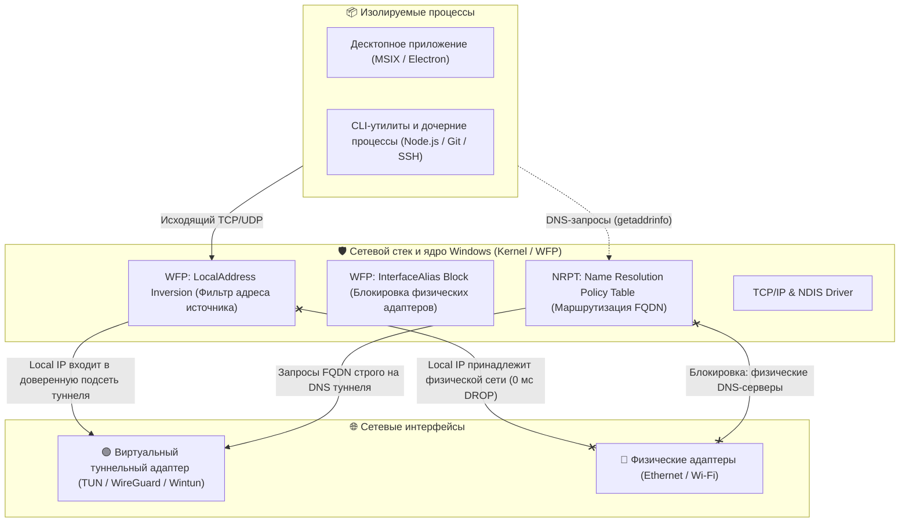

# Техническая архитектура: Механизм строгой сетевой изоляции процессов на Windows 11 (WFP & NRPT)

Данный документ представляет собой техническое описание архитектуры отказоустойчивой сетевой изоляции (Fail-Closed Network Isolation) клиентских процессов на платформе Windows 11 с использованием подсистемы Windows Filtering Platform (WFP) и политик разрешения имен (NRPT).

---

## 1. Концепция и цели архитектуры

Основная инженерная задача — гарантировать, что заданная группа процессов (графическое десктоп-приложение и сопутствующие CLI-утилиты) может осуществлять исходящие сетевые подключения **исключительно через назначенный виртуальный сетевой интерфейс (туннель)**.

### Ключевые системные требования:
* **Принцип Fail-Closed (0 мс Drop):** при деградации, разрыве или отключении туннельного интерфейса сетевой стек операционной системы должен немедленно блокировать исходящий трафик изолируемых процессов. Не допускается переключение сокетов на физические сетевые адаптеры (Ethernet / Wi-Fi).
* **Изоляция на уровне ядра:** блокировка должна реализовываться средствами NDIS/WFP на уровне ядра операционной системы, а не через высокоуровневые пользовательские демоны мониторинга с интервалами опроса.
* **Изоляция DNS:** системный сервис разрешения доменных имен (`svchost.exe / Dnscache`) не должен направлять запросы изолируемых доменов на DNS-серверы физических адаптеров.
* **Атомарность конфигурации:** обновление правил фильтрации должно происходить без возникновения окон гонки состояний (TOCTOU).

---

## 2. Диаграмма архитектуры и потоков данных



---

## 3. Компоненты эшелонированной защиты

### 3.1. Инверсия адреса источника (WFP LocalAddress Inversion)
* **Механика:** вместо динамического отслеживания статуса интерфейсов в фаерволе Windows 24/7 поддерживаются постоянные правила блокировки исходящего трафика для изолируемых бинарников.
* **Фильтрация:** блокируются все адреса источника (`LocalAddress`), кроме подсети туннельного адаптера (например, `100.64.0.0/10` или `10.0.0.0/8`) и локального интерфейса замыкания на себя (`127.0.0.1` для межпроцессного взаимодействия IPC).
* **Результат:** если туннельный интерфейс деактивирован, сетевой стек пытается привязать сокет к IP-адресу физического адаптера хоста (например, `192.168.x.x`). Этот диапазон уже находится в списке запрещенных, поэтому драйвер WFP сбрасывает пакеты моментально (0 миллисекунд), без задержек на реакцию пользовательских служб.

### 3.2. Атомарное обновление правил (Make-Before-Break)
* Для предотвращения состояния гонки (TOCTOU) при синхронизации правил применяется стратегия **Make-Before-Break**:
  1. Генерируется уникальный идентификатор генерации (`Gen<timestamp>`).
  2. Новые правила создаются и активируются в WFP.
  3. Только после успешного применения новых правил производится удаление правил предыдущей генерации.

### 3.3. Контроль системного DNS (NRPT & SMHNR)
* **NRPT (Name Resolution Policy Table):** через командлет `Add-DnsClientNrptRule` создаются правила для целевых пространств имен (`.example-backend.com` и др.), принудительно назначающие внутренний IP-адрес DNS-сервера туннеля. При недоступности туннеля системный клиент `svchost.exe` возвращает ошибку и не выполняет fallback на физические интерфейсы.
* **Отключение SMHNR:** параметр `DisableSmartNameResolution = 1` в политиках Windows отключает одновременную параллельную рассылку DNS-запросов по всем доступным адаптерам.
* **Отключение LLMNR:** параметр `EnableMulticast = 0` предотвращает локальные широковещательные утечки имен.

### 3.4. Управление протоколом IPv6
* Отключение привязки компонента `ms_tcpip6` на физических сетевых интерфейсах через командлет `Disable-NetAdapterBinding`.
* Назначение приоритета IPv4 над IPv6 согласно RFC 3484 (`DisabledComponents = 0x20` в параметрах TCP/IP реестра).
* Блокировка диапазонов IPv6 в правилах фаервола WFP для целевых процессов.

### 3.5. Отслеживание жизненного цикла MSIX / AppX
* Изолируемое десктоп-приложение распространяется как MSIX-пакет. Правила WFP связываются с постоянным идентификатором `PackageFamilyName`, что обеспечивает сохранение фильтрации при автоматических обновлениях пакета операционной системой.
* Предстартовый лаунчер производит верификацию актуального пути бинарного файла (`C:\Program Files\WindowsApps\...`) и при обнаружении расхождений с активными фильтрами WFP выполняет обновление правил с проверкой по принципу Fail-Closed.

### 3.6. Фоновая синхронизация (Task Scheduler)
* Регистрация задания Планировщика задач Windows (`NetCage-BootSync`) с триггерами при загрузке системы (`AtStartup`) и входе пользователя (`AtLogOn`), выполняющегося от учетной записи `NT AUTHORITY\SYSTEM` с наивысшими правами (`RunLevel Highest`).

---

## 4. Спецификация реализации ключевых модулей

### 4.1. Конфигурация WFP-фильтрации (`Sync-AppFirewall.ps1`)

```powershell
# Определение целевых подсетей инверсии
$blockedLocalIpRanges = @(
    "0.0.0.0-100.63.255.255",
    "100.128.0.0-126.255.255.255",
    "128.0.0.0-255.255.255.255"
)

# Перечень целевых объектов: PackageFamilyName и прямые бинарные пути
# Правило 1: Инверсия LocalAddress
New-NetFirewallRule -Name "NetCage-$genTag-LocalInv-$safeName" `
    -DisplayName "NetCage: Block Non-Tunnel Source IP for $targetName" `
    -Group "NetCageKillSwitch" `
    -Direction Outbound -Action Block `
    -Program $targetPath `
    -LocalAddress $blockedLocalIpRanges `
    -Enabled True

# Правило 2: Блокировка физических интерфейсов
New-NetFirewallRule -Name "NetCage-$genTag-Adapter-$safeName" `
    -DisplayName "NetCage: Block Physical Adapters for $targetName" `
    -Group "NetCageKillSwitch" `
    -Direction Outbound -Action Block `
    -Program $targetPath `
    -InterfaceAlias $physicalAdapterAliases `
    -Enabled True

# Правило 3: Блокировка прямого LAN-трафика (RFC 1918)
New-NetFirewallRule -Name "NetCage-$genTag-Lan-$safeName" `
    -DisplayName "NetCage: Block Local LAN for $targetName" `
    -Group "NetCageKillSwitch" `
    -Direction Outbound -Action Block `
    -Program $targetPath `
    -RemoteAddress @("192.168.0.0/16", "172.16.0.0/12", "169.254.0.0/16", "224.0.0.0/4") `
    -Enabled True
```

### 4.2. Конфигурация политик разрешения имен (`Set-DnsHardening.ps1`)

```powershell
# Регистрация FQDN в Name Resolution Policy Table
Add-DnsClientNrptRule -Namespace $targetNamespaces -Nameserver $tunnelDnsServer -Comment "NetCageNRPT"

# Системные политики DNS и многоадресного разрешения
Set-ItemProperty -Path "HKLM:\SOFTWARE\Policies\Microsoft\Windows NT\DNSClient" -Name "DisableSmartNameResolution" -Value 1 -Type DWord
Set-ItemProperty -Path "HKLM:\SOFTWARE\Policies\Microsoft\Windows NT\DNSClient" -Name "EnableMulticast" -Value 0 -Type DWord

# RFC 3484 IPv4 Preference
Set-ItemProperty -Path "HKLM:\SYSTEM\CurrentControlSet\Services\Tcpip6\Parameters" -Name "DisabledComponents" -Value 0x20 -Type DWord

# Снятие привязки IPv6 на физических интерфейсах
Get-NetAdapter -Physical | Disable-NetAdapterBinding -ComponentId ms_tcpip6
Clear-DnsClientCache
```

---

## 5. Вопросы для системного и архитектурного аудита

1. **Обработка сокетов в WFP при изменении топологии маршрутизации:**
   - Если сокет был открыт с привязкой к `INADDR_ANY (0.0.0.0:0)` до падения туннеля, гарантирует ли слой фильтрации `ALE_AUTH_CONNECT_V4` и `TRANSPORT_V4`, что последующие пакеты с измененным локальным IP физического адаптера будут заблокированы правилом `LocalAddress Inversion`?
   - Существуют ли известные сценарии в NDIS 6.x, при которых пакет может обойти фильтр уровня приложения (например, через WFP Callout драйверы сторонних сетевых служб)?

2. **Отказоустойчивость NRPT:**
   - Существуют ли условия, при которых сервис `Dnscache` (Windows DNS Client) может проигнорировать запись NRPT и выполнить откат (fallback) на публичные DNS-серверы физического интерфейса (например, при длительном отсутствии ответа от туннельного DNS)?
   - Требуется ли дополнительная блокировка UDP/TCP порта 53 на физических интерфейсах хоста для полного исключения непрямых запросов?

3. **Dual-Stack и IPv6 преобразования:**
   - Полностью ли исключается утечка данных при использовании IPv4-mapped IPv6 адресов (`::ffff:192.168.x.x`) в среде исполнения Node.js / V8 при описанной конфигурации?

4. **Атомарность и межпроцессное взаимодействие:**
   - Присутствуют ли скрытые временные окна гонки состояний при обновлении пакета MSIX и одновременном запуске процессов пользователем до отработки фонового задания планировщика?
