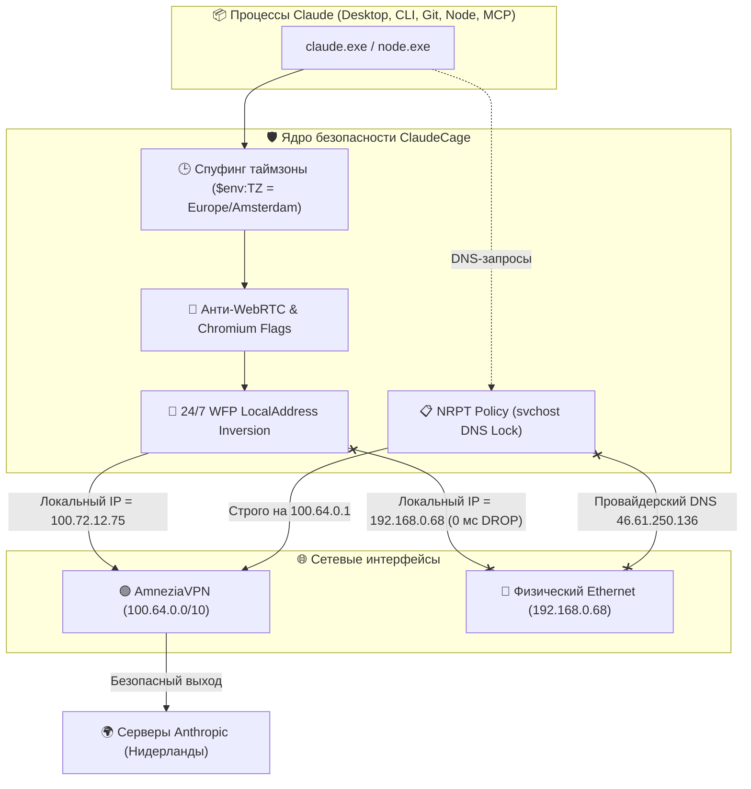

# 🛡️ ClaudeCage: Цифровой бункер для Claude на Windows 11

> **Краткий статус:** Вся среда полностью развернута, протестирована и зафиксирована в Git тегом `v6-audit-hardened`.

---

## ☕ 1. Что это такое простыми словами (TL;DR)

Представь, что **Claude Desktop** (приложение с окном) и **Claude Code** (терминальная утилита) живут в **цифровой звуконепроницаемой комнате с бронированной дверью**:

1. **Единственный выход наружу — туннель AmneziaVPN.**
   Claude физически не знает, что у твоего компьютера есть обычный кабель интернета или домашний Wi-Fi. Он видит только защищенный зашифрованный туннель.
2. **Идеальная маскировка под европейца:**
   Claude на 100% уверен, что находится в Нидерландах: у него голландский IP-адрес, амстердамское системное время (UTC+2) и чистая английская локаль.
3. **Железный принцип Fail-Closed:**
   - **VPN включен** → Claude спокойно работает на максимальной скорости.
   - **VPN выключен или внезапно оборвался** → для Claude интернет **мгновенно умирает на корню**. Он не видит ни твоего настоящего провайдера, ни твоего города. С его точки зрения, во всем доме просто выдернули сетевой провод.

---

## 🧩 2. Почему обычный VPN без клетки «дырявый»?

Большинство людей думают: *«Я включил VPN на компьютере, значит я полностью защищен»*. **На Windows это опасная иллюзия.** 

Вот как умные антифрод-системы (Cloudflare, Arkose Labs, Anthropic) легко вычисляют реальное местоположение через стандартный VPN:

```
❌ ОБЫЧНЫЙ VPN (БЕЗ КЛЕТКИ):
[Claude] ────> Запрос времени ────> Видит таймзону Windows: Europe/Moscow (+03:00) ──> ⚠️ БАН!
[Claude] ────> Запрос WebRTC  ────> Сливает домашний IP: 192.168.0.68 ───────────────> ⚠️ БАН!
[Windows] ───> Запрос DNS     ────> Опрашивает домашний DNS провайдера РФ параллельно > ⚠️ БАН!
[VPN упал] ──> Реконнект      ────> Пакет мгновенно летит через физический кабель ───> ⚠️ БАН!
```

---

## 🚀 3. Как устроен ClaudeCage и почему это круто

Внутри ClaudeCage реализована многоуровневая эшелонированная оборона на уровне ядра операционной системы:



---

### 💎 4 уникальные инженерные фичи клетки

### 1. Master-замок: Инверсия Source IP (`LocalAddress`) со скоростью 0 мс
> [!TIP]
> **Как это работает:** Вместо того чтобы при падении VPN судорожно запускать скрипты и ставить блокировки (теряя драгоценные 2–3 секунды гонки), мы применили **математическую инверсию IP-адреса источника**.
> 
> В фаерволе Windows 24/7 висит постоянное правило: исходящий трафик для Claude **заблокирован со всех IP-адресов в мире**, КРОМЕ подсети туннеля Amnezia (`100.64.0.0/10`) и локального хоста (`127.0.0.1`).
> 
> Когда VPN рвется, сетевой сокет пытается переключиться на твой домашний IP `192.168.0.68`. Но диапазон `192.x` **уже заблокирован в ядре**! Пакет уничтожается сетевым драйвером за **0 миллисекунд**.

---

### 2. Защита от утечек через системный DNS (`svchost.exe`)
> [!IMPORTANT]
> **Скрытая ловушка Windows:** Приложения не всегда резолвят домены сами — часто они просят об этом системную службу Windows DNS Client (`svchost.exe`). Если приложение заблокировано в фаерволе, `svchost.exe` все равно мог отправить запрос к провайдеру!
> 
> **Наше решение — NRPT (Name Resolution Policy Table):** На уровне ядра Windows для всех доменов `*.anthropic.com`, `*.claude.ai` и сопутствующих прописано жесткое правило: опрашивать **исключительно** внутренний DNS туннеля `100.64.0.1`. Если туннель выключен, `svchost.exe` просто выдает ошибку и ни при каких условиях не пойдет к твоему провайдеру.

---

### 3. Защита от «воскрешения из трея» и антифрод
> [!NOTE]
> При закрытии Claude Desktop на крестик окно сворачивается в трей и сохраняет старые настройки. Наш лаунчер [`Start-ClaudeDesktop.ps1`](file:///C:/ClaudeCage/Start-ClaudeDesktop.ps1):
> 1. Принудительно очищает зависшие фоновые процессы в трее.
> 2. Заново инжектирует правильную таймзону `Europe/Amsterdam`.
> 3. Добавляет валидные флаги подавления WebRTC: `--force-webrtc-ip-handling-policy=disable_non_proxied_udp`.
> 4. Отключает доступ к системному датчику геолокации Windows.

---

### 4. Атомарное обновление (Make-Before-Break)
> [!CAUTION]
> Большинство простых скриптов фаервола делают так: *«Удалить старые правила → Создать новые»*. В этот момент возникает «дыра» в несколько секунд, пока создаются новые правила.
> 
> В ClaudeCage применен принцип **Make-Before-Break**: новые правила сначала полностью создаются и активируются с новым уникальным тегом генерации, и только после подтверждения их работы удаляются предыдущие. Система ни на секунду не остается голой.

---

## 📊 4. Сравнительная таблица: Было vs Стало

| Параметр | Обычный ПК с VPN | ClaudeCage (v6-audit-hardened) |
| :--- | :--- | :--- |
| **Падение VPN на лету** | Трафик мгновенно утекает через домашний IP | 🛑 **0 мс Drop** на уровне ядра (LocalAddress Inversion) |
| **DNS-запросы** | Шлются параллельно на DNS провайдера РФ (SMHNR) | 🔒 Заперты политикой **NRPT** на DNS туннеля `100.64.0.1` |
| **WebRTC IP Leak** | Браузер сливает домашний `192.168.0.68` через STUN | 🛡️ WebRTC заблокирован аппаратными флагами Chromium |
| **Таймзона в Claude** | Московское время `UTC+3` (несовпадение с IP) | 🕒 Принудительно спуфится под страну VPN (`Europe/Amsterdam`) |
| **Дочерние процессы** | `git push` и MCP-серверы идут в обход VPN | 📦 `git-remote-https.exe`, `ssh.exe`, MCP-бинарники под защитой |
| **Автообновление MSIX** | Смена версии ломает пути правил | 🔄 Динамический поиск по шаблону `Claude_*` в `WindowsApps` |

---

## 🕹️ 5. Шпаргалка команд на каждый день

### 🔹 Запуск десктопного приложения
Кликни ярлык на рабочем столе: **`Claude (Secure Cage)`**  
или выполни в PowerShell:
```powershell
& "C:\ClaudeCage\Start-ClaudeDesktop.ps1"
```

### 🔹 Запуск терминального Claude Code (CLI)
Хук уже встроен в твой профиль PowerShell. Просто напиши:
```powershell
claude
```

### 🔹 Мониторинг сокетов в реальном времени (Логгер клетки)
Если хочешь своими глазами увидеть, как ядро пропускает или режет пакеты:
```powershell
& "C:\ClaudeCage\Watch-ClaudeCage.ps1"
```

### 🔹 Полный аудит безопасности (9 тестов)
В любой момент проверить отсутствие утечек:
```powershell
& "C:\ClaudeCage\Test-CageLeaks.ps1" -Detailed
```

### 🔹 Кнопка полного отката (Вернуть систему к заводскому состоянию)
Если клетка больше не нужна, один клик возвращает систему в состояние до любых изменений:
```powershell
& "C:\ClaudeCage\Rollback-System.ps1"
```
