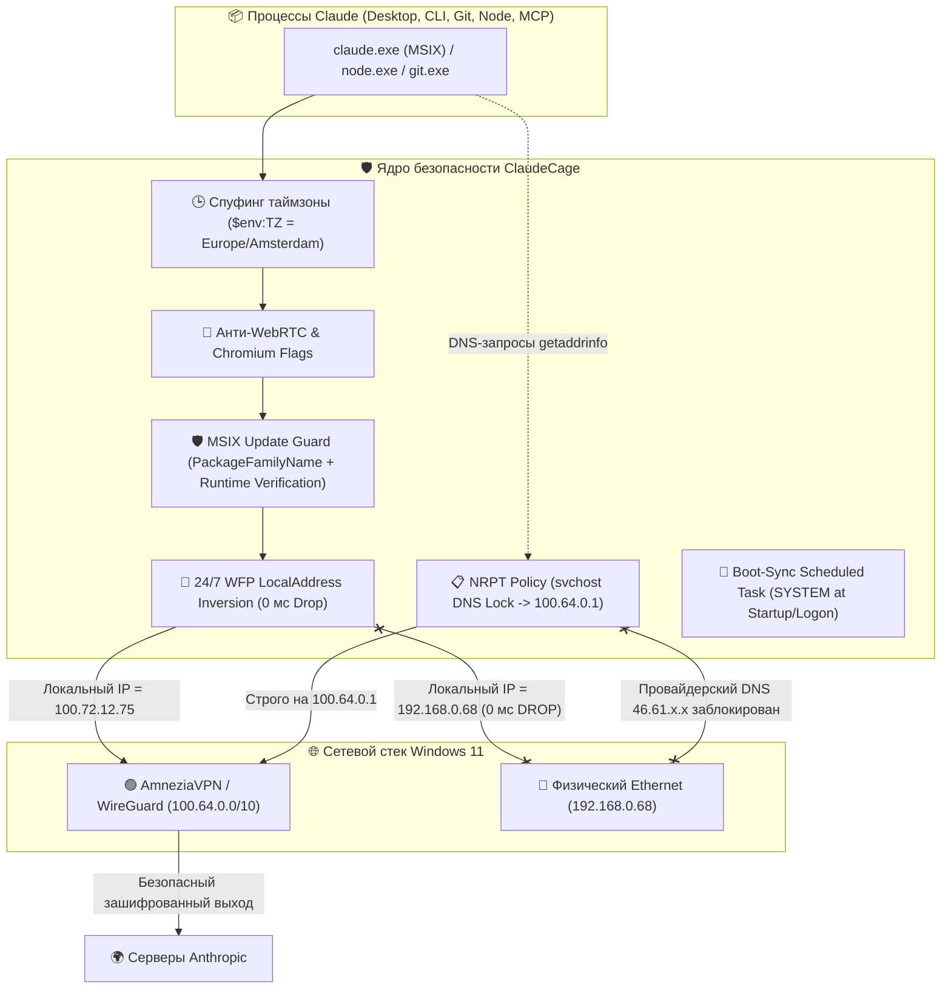

# 🏛️ CLAUDECAGE ARCHITECTURAL DOSSIER & COMPLETE CODEBASE FOR GEMINI ARGON 4 AUDIT

**Проект:** ClaudeCage (v6.1-release)  
**Платформа:** Windows 11 Pro / Enterprise (x64), NDIS 6.x, Windows Filtering Platform (WFP)  
**Целевые приложения:** 
- **Claude Desktop** (Electron 30+ / Chromium V8, распространяется как Windows Store MSIX / AppX пакет `Claude_pzs8sxrjxfjjc`)
- **Claude Code CLI** (Node.js runtime, утилита командной строки `@anthropic-ai/claude-code`, порождающая дочерние процессы `git.exe`, `ssh.exe`, MCP-серверы)
**Сетевой контекст:** AmneziaVPN (WireGuard / Wintun, подсеть CGNAT `100.64.0.0/10`, шлюз DNS `100.64.0.1`) с поддержкой любых WireGuard / OpenVPN / TUN адаптеров (`10.0.0.0/8`).

---

## 📋 ЧАСТЬ 1. СУТЬ ПРОЕКТА, ТРЕБОВАНИЯ И АРХИТЕКТУРА БЕЗОПАСНОСТИ

### 1.1. Главная цель проекта
Создать **100% герметичный, аппаратный программный бункер («клетку»)** в операционной системе Windows 11, гарантирующий следующее поведение:
1. **Строгий Fail-Closed режим:** Claude (как десктопное приложение, так и терминальный CLI) имеет доступ в сеть **строго и только через VPN-туннель**.
2. **Мгновенный обрыв при сбое VPN (0 мс Drop):** Если VPN-туннель падает, отключается пользователем или уходит в цикл переподключения, трафик Claude блокируется драйвером ядра Windows Filtering Platform **в ту же микросекунду (за 0 миллисекунд)**. Ни единый TCP SYN или UDP пакет не имеет права выйти через физический адаптер (Ethernet / Wi-Fi, `192.168.0.x`). Для Claude ситуация выглядит как физическое отключение сетевого кабеля («No internet connection»).
3. **Антифрод-стелс и целостность телеметрии:**
   - **Спуфинг таймзоны:** `$env:TZ` динамически выставляется под геолокацию выходного узла VPN (например, `Europe/Amsterdam`), маскируя системное московское время Windows (`Europe/Moscow`, UTC+3) в движке V8.
   - **Подавление WebRTC STUN:** Chromium запускается с флагами `--force-webrtc-ip-handling-policy=disable_non_proxied_udp`, блокирующими сканирование локальных интерфейсов хоста.
   - **Защита системного DNS (NRPT):** Все домены Anthropic (`.anthropic.com`, `.claude.ai`, `.claude.com`, `.sentry.io`, `.stripe.com`, `.intercom.io`) на уровне ядра через Name Resolution Policy Table (NRPT) замкнуты на внутренний DNS туннеля (`100.64.0.1`). Системная служба `svchost.exe (Dnscache)` физически не опрашивает домашний DNS провайдера РФ.
   - **Отключение SMHNR и IPv6:** Smart Multi-Homed Name Resolution отключен, протокол IPv6 отключен на физическом адаптере хоста.
4. **Устойчивость к автообновлениям MSIX Windows Store:**
   - MSIX-пакеты обновляются без предупреждения в новую папку `C:\Program Files\WindowsApps\Claude_<new_version>_\app\claude.exe`.
   - В ядре WFP правила привязаны к неизменному `PackageFamilyName: Claude_pzs8sxrjxfjjc` (действуют на любую версию пакета).
   - Лаунчер перед запуском верифицирует покрытие актуального бинарника в активных фильтрах фаервола; если обнаружен непокрытый бинарник, запрашивается разовый UAC для пересинхронизации, а при отказе запуск немедленно прерывается (`exit 1` Fail-Closed).
5. **Автозагрузка и бесшовность:**
   - Системное задание `ClaudeCage-BootSync` в Windows Task Scheduler при загрузке системы (`AtStartup`) и входе пользователя (`AtLogOn`) от имени `NT AUTHORITY\SYSTEM` синхронизирует правила WFP без всплывающих окон.
   - Стандартный ярлык `Claude` на рабочем столе и в меню «Пуск» заменен на защищенный ярлык со скрытым окном (`-WindowStyle Hidden`) и официальной 256px иконкой `claude.ico`.

---

### 1.2. Архитектурная схема (Mermaid)



---

## 📂 ЧАСТЬ 2. СТРУКТУРА ФАЙЛОВ ПРОЕКТА

```text
C:\ClaudeCage\
├── Setup.bat                     # 1-Click установщик с авто-запросом прав Администратора
├── Setup-ClaudeCage.ps1          # Оркестратор развертывания, бэкапа и верификации
├── Start-ClaudeDesktop.ps1       # Безопасный лаунчер Claude Desktop с антифродом и MSIX-контролем
├── Invoke-ClaudeCLI.ps1          # Безопасный лаунчер Claude Code CLI с контролем WFP
├── Sync-ClaudeFirewall.ps1       # Ядро WFP: 24/7 LocalAddress Inversion, Make-Before-Break
├── Set-DnsHardening.ps1          # Настройка NRPT, SMHNR, LLMNR, RFC 3484, Location Guard
├── Watch-ClaudeCage.ps1          # Реалтайм логгер сокетов и телеметрии WFP
├── Test-CageLeaks.ps1            # Тестовый аудит на 9 проверок безопасности
├── Install-ClaudeShortcut.ps1    # Генератор бесшовных ярлыков с извлечением 256px иконки
├── Install-ClaudeProfileHook.ps1 # Хук команды 'claude' в $PROFILE пользователя
├── Initialize-SandboxBins.ps1    # Изоляция локальных node.exe и curl.exe в C:\ClaudeCage\bin
├── Rollback-System.ps1           # 1-Click откат системы к исходному снимку (v0-baseline)
├── .gitignore                    # Изоляция персональных данных бэкапов и логов хоста
├── claude.ico                    # Официальная 256x256 иконка высокого разрешения
├── README.md                     # Документация для быстрого старта на других ПК
├── ARCHITECTURE.md               # Глубокая техническая спецификация уровней защиты
└── CLAUDECAGE_EXPLAINED.md       # Понятное объяснение концепций для пользователей
```

---

## 💻 ЧАСТЬ 3. ПОЛНЫЙ ИСХОДНЫЙ КОД ВСЕХ ФАЙЛОВ

### 3.1. `Setup.bat`
```bat
@echo off
:: ClaudeCage 1-Click Administrator Launcher
title ClaudeCage Windows 11 Installer
echo ==========================================================
echo        Starting ClaudeCage Installer (Windows 11)
echo ==========================================================
echo.
echo Requesting Administrator privileges...

powershell -NoProfile -ExecutionPolicy Bypass -Command "Start-Process powershell.exe -ArgumentList '-NoProfile -ExecutionPolicy Bypass -NoExit -File \"\"%~dp0Setup-ClaudeCage.ps1\"\"' -Verb RunAs"

exit /b
```

---

### 3.2. `Setup-ClaudeCage.ps1`
```powershell
<#
.SYNOPSIS
    Setup-ClaudeCage.ps1 - Automated 1-Click Installer & Deployer for ClaudeCage on Windows 11.
.DESCRIPTION
    Deploys the complete ClaudeCage sandbox environment on any Windows 11 machine:
    1. Verifies Administrator rights (prompts UAC if needed).
    2. Ensures root directory is C:\ClaudeCage (copies files if launched from elsewhere).
    3. Creates a local baseline system snapshot (registry, firewall, profile, DNS) for 1-click rollback.
    4. Provisions isolated sandbox binaries (node.exe, curl.exe) into C:\ClaudeCage\bin.
    5. Applies kernel DNS & IPv6 hardening (NRPT rules, SMHNR disabled, Location Guard).
    6. Deploys 24/7 atomic WFP Fail-Closed Kill Switch rules (LocalAddress Inversion).
    7. Hooks the 'claude' CLI command into the user's PowerShell $PROFILE.
    8. Creates a desktop shortcut 'Claude' pointing to the secured launcher.
    9. Registers background boot-sync scheduled task (ClaudeCage-BootSync).
    10. Executes the comprehensive 9-point security audit (Test-CageLeaks.ps1).
#>

[CmdletBinding()]
param(
    [switch]$SkipTest,
    [switch]$ForceBaseline
)

$ErrorActionPreference = 'Stop'

function Test-Admin {
    $currentUser = [Security.Principal.WindowsIdentity]::GetCurrent()
    $principal = New-Object Security.Principal.WindowsPrincipal($currentUser)
    return $principal.IsInRole([Security.Principal.WindowsBuiltInRole]::Administrator)
}

if (-not (Test-Admin)) {
    Write-Host "[!] Administrator privileges required. Requesting elevation..." -ForegroundColor Yellow
    $scriptPath = $MyInvocation.MyCommand.Definition
    Start-Process powershell.exe -ArgumentList "-NoProfile -ExecutionPolicy Bypass -File `"$scriptPath`"" -Verb RunAs
    exit 0
}

Clear-Host
Write-Host "==========================================================" -ForegroundColor Cyan
Write-Host "     CLAUDECAGE: 1-CLICK AUTOMATED DEPLOYMENT (WIN 11)    " -ForegroundColor Cyan
Write-Host "==========================================================" -ForegroundColor Cyan

$TargetRoot = "C:\ClaudeCage"
$CurrentDir = $PSScriptRoot

# 1. Ensure installation directory is C:\ClaudeCage
if ($CurrentDir -ne $TargetRoot) {
    Write-Host "`n[*] [1/7] Relocating files from $CurrentDir to $TargetRoot..." -ForegroundColor Yellow
    if (-not (Test-Path $TargetRoot)) {
        New-Item -ItemType Directory -Path $TargetRoot -Force | Out-Null
    }
    Copy-Item -Path "$CurrentDir\*" -Destination $TargetRoot -Recurse -Force
    Set-Location $TargetRoot
    Write-Host "    [OK] Environment relocated to $TargetRoot." -ForegroundColor Green
} else {
    Write-Host "`n[*] [1/7] Verified root directory: $TargetRoot" -ForegroundColor Green
}

Set-Location $TargetRoot

# 2. Local Baseline Snapshot (Unique to this machine)
$BaselineDir = Join-Path $TargetRoot "backups\baseline"
$baselineMarker = Join-Path $BaselineDir "system_baseline_created.txt"

Write-Host "`n[*] [2/7] Checking local system baseline backup..." -ForegroundColor Yellow
if (-not (Test-Path $baselineMarker) -or $ForceBaseline) {
    if (-not (Test-Path $BaselineDir)) {
        New-Item -ItemType Directory -Path $BaselineDir -Force | Out-Null
    }

    Write-Host "    Creating initial machine snapshot for Rollback-System.ps1..." -ForegroundColor DarkYellow
    reg export "HKLM\SYSTEM\CurrentControlSet\Services\Dnscache\Parameters" (Join-Path $BaselineDir "Dnscache_Parameters.reg") /y | Out-Null
    reg export "HKLM\SYSTEM\CurrentControlSet\Services\Tcpip\Parameters" (Join-Path $BaselineDir "Tcpip_Parameters.reg") /y | Out-Null
    reg export "HKLM\SOFTWARE\Policies\Microsoft\Windows NT\DNSClient" (Join-Path $BaselineDir "DNSClient_Policies.reg") /y | Out-Null
    reg export "HKLM\SYSTEM\CurrentControlSet\Services\Tcpip6\Parameters" (Join-Path $BaselineDir "Tcpip6_Parameters.reg") /y | Out-Null

    if (Test-Path $PROFILE) {
        Copy-Item $PROFILE (Join-Path $BaselineDir "user_profile.ps1") -Force
    } else {
        Set-Content (Join-Path $BaselineDir "profile_did_not_exist.txt") "Profile did not exist at baseline" -Force
    }

    netsh advfirewall export (Join-Path $BaselineDir "firewall_baseline.wfw") | Out-Null
    Get-NetFirewallRule | Select-Object Name, DisplayName, Direction, Action, Enabled, Program | Export-Clixml (Join-Path $BaselineDir "firewall_rules_baseline.xml")
    Get-NetAdapterBinding | Export-Clixml (Join-Path $BaselineDir "adapter_bindings_baseline.xml")
    Get-DnsClientServerAddress | Export-Clixml (Join-Path $BaselineDir "dns_addresses_baseline.xml")

    Set-Content -Path $baselineMarker -Value "Baseline snapshot captured on $env:COMPUTERNAME at $(Get-Date -Format 'o')" -Force
    Write-Host "    [OK] Local machine baseline saved in backups\baseline." -ForegroundColor Green
} else {
    Write-Host "    [OK] Baseline snapshot already exists. Keeping original for rollback safety." -ForegroundColor Gray
}

# 3. Provision Caged Binaries (node.exe & curl.exe)
Write-Host "`n[*] [3/7] Provisioning isolated sandbox binaries in C:\ClaudeCage\bin..." -ForegroundColor Yellow
$initBinsScript = Join-Path $TargetRoot "Initialize-SandboxBins.ps1"
if (Test-Path $initBinsScript) {
    & $initBinsScript
} else {
    $CageBin = Join-Path $TargetRoot "bin"
    if (-not (Test-Path $CageBin)) { New-Item -ItemType Directory -Path $CageBin -Force | Out-Null }
    $nodeSrc = (Get-Command node.exe -ErrorAction SilentlyContinue).Source
    if (-not $nodeSrc) { $nodeSrc = "C:\Program Files\nodejs\node.exe" }
    if (Test-Path $nodeSrc) { Copy-Item $nodeSrc (Join-Path $CageBin "node.exe") -Force }

    $curlSrc = (Get-Command curl.exe -ErrorAction SilentlyContinue).Source
    if (-not $curlSrc) { $curlSrc = "C:\Windows\System32\curl.exe" }
    if (Test-Path $curlSrc) { Copy-Item $curlSrc (Join-Path $CageBin "curl.exe") -Force }
}

# 4. Kernel DNS & Anti-Leak Hardening (NRPT + SMHNR)
Write-Host "`n[*] [4/7] Applying Kernel DNS (NRPT) & Anti-Leak Hardening..." -ForegroundColor Yellow
$dnsScript = Join-Path $TargetRoot "Set-DnsHardening.ps1"
if (Test-Path $dnsScript) {
    & $dnsScript
}

# 5. Enforce 24/7 WFP Fail-Closed Kill Switch (LocalAddress Inversion)
Write-Host "`n[*] [5/7] Deploying 24/7 WFP Kill Switch (LocalAddress Inversion)..." -ForegroundColor Yellow
$syncScript = Join-Path $TargetRoot "Sync-ClaudeFirewall.ps1"
if (Test-Path $syncScript) {
    & $syncScript -Enforce
}

# 6. Setup Shortcuts and Profile Hook
Write-Host "`n[*] [6/7] Configuring CLI profile hook and desktop shortcut..." -ForegroundColor Yellow

# PowerShell profile hook
$hookScript = Join-Path $TargetRoot "Install-ClaudeProfileHook.ps1"
if (Test-Path $hookScript) {
    & $hookScript
}

# Desktop & Start Menu Shortcuts
$shortcutScript = Join-Path $TargetRoot "Install-ClaudeShortcut.ps1"
if (Test-Path $shortcutScript) {
    & $shortcutScript
}

# Set PowerShell execution policy for CurrentUser
try {
    Set-ExecutionPolicy -Scope CurrentUser -ExecutionPolicy RemoteSigned -Force -ErrorAction SilentlyContinue
} catch {}

# 7. Configure Background Auto-Sync Task (Runs at Startup and Logon)
Write-Host "`n[*] [7/8] Registering Windows Scheduled Task for 24/7 boot synchronization..." -ForegroundColor Yellow
try {
    $action = New-ScheduledTaskAction -Execute "powershell.exe" -Argument "-NoProfile -ExecutionPolicy Bypass -WindowStyle Hidden -File `"$TargetRoot\Sync-ClaudeFirewall.ps1`" -Enforce"
    $triggers = @(
        (New-ScheduledTaskTrigger -AtStartup),
        (New-ScheduledTaskTrigger -AtLogOn)
    )
    $principal = New-ScheduledTaskPrincipal -UserId "NT AUTHORITY\SYSTEM" -LogonType ServiceAccount -RunLevel Highest
    $settings = New-ScheduledTaskSettingsSet -AllowStartIfOnBatteries -DontStopIfGoingOnBatteries
    Register-ScheduledTask -TaskName "ClaudeCage-BootSync" -Action $action -Trigger $triggers -Principal $principal -Settings $settings -Force | Out-Null
    Write-Host "    [OK] Task 'ClaudeCage-BootSync' registered (triggers at system boot and logon)." -ForegroundColor Green
} catch {
    Write-Warning "    [-] Could not register boot task: $_"
}

# 8. Verification Audit
Write-Host "`n[*] [8/8] Running initial security & leak audit..." -ForegroundColor Yellow
if (-not $SkipTest) {
    $testScript = Join-Path $TargetRoot "Test-CageLeaks.ps1"
    if (Test-Path $testScript) {
        & $testScript -Detailed
    }
}

Write-Host "`n==========================================================" -ForegroundColor Green
Write-Host "   CLAUDECAGE INSTALLATION COMPLETE! SYSTEM IS SECURED    " -ForegroundColor Green
Write-Host "==========================================================" -ForegroundColor Green
Write-Host @"

  HOW TO USE:
  1. Claude Desktop (GUI):
     Double-click the standard 'Claude' icon on your Desktop or Start Menu (runs securely in cage).

  2. Claude Code (CLI):
     Open any PowerShell terminal and type:
     > claude

  3. Live Traffic Monitor:
     > & "$TargetRoot\Watch-ClaudeCage.ps1"

  4. Emergency 1-Click Rollback:
     > & "$TargetRoot\Rollback-System.ps1"

"@ -ForegroundColor Cyan
```

---

### 3.3. `Sync-ClaudeFirewall.ps1`
```powershell
<#
.SYNOPSIS
    Sync-ClaudeFirewall.ps1 - Core 24/7 Fail-Closed WFP Kill Switch Engine for ClaudeCage.
.DESCRIPTION
    Implements:
    1. Static 24/7 LocalAddress Inversion (0-ms physical egress drop without race conditions)
    2. Atomic Make-Before-Break rule transitions (Gen<timestamp> tags eliminate TOCTOU)
    3. Universal VPN Detection (AmneziaVPN prioritized, generic VPN support)
    4. Comprehensive Process Target Discovery:
       - Caged Node & Curl (C:\ClaudeCage\bin)
       - Standalone Claude CLI (npm global binaries)
       - Claude Desktop MSIX PackageFamilyName (survives store updates)
       - All Claude Desktop versions found in C:\Program Files\WindowsApps
       - Git networking binaries (git.exe, git-remote-https.exe, ssh.exe)
       - Dynamic MCP server executables parsed from claude_desktop_config.json
    5. Multi-Layer Leak Prevention:
       - Rule 1: LocalAddress Inversion (Blocks non-VPN source IPs 24/7)
       - Rule 2: InterfaceAlias filter (Blocks physical adapters)
       - Rule 3: LAN & STUN leak block (RFC 1918 subnets)
       - Rule 4: Dual-layer IPv6 Block (Blocks discrete IPv6 ranges & adapter bindings)
#>

[CmdletBinding()]
param(
    [switch]$Enforce,
    [switch]$Remove,
    [switch]$Status
)

$ErrorActionPreference = 'Stop'

$CageRoot  = "C:\ClaudeCage"
$CageBin   = Join-Path $CageRoot "bin"
$GroupName = "ClaudeKillSwitch"

function Test-Admin {
    $currentUser = [Security.Principal.WindowsIdentity]::GetCurrent()
    $principal = New-Object Security.Principal.WindowsPrincipal($currentUser)
    return $principal.IsInRole([Security.Principal.WindowsBuiltInRole]::Administrator)
}

if (-not (Test-Admin)) {
    Write-Error "[!] Administrator privileges are required to run Sync-ClaudeFirewall.ps1."
    exit 1
}

function Get-ActiveVpnAdapter {
    $amnezia = Get-NetAdapter | Where-Object { 
        ($_.Name -like "*Amnezia*" -or $_.InterfaceDescription -like "*Amnezia*") -and $_.Status -eq "Up" 
    } | Select-Object -First 1
    if ($amnezia) { return $amnezia }

    $vpn = Get-NetAdapter | Where-Object {
        $_.Status -eq "Up" -and (
            $_.InterfaceDescription -match "WireGuard|Wintun|TUN|TAP|OpenVPN|Tailscale|VPN" -or
            $_.Name -match "VPN|WireGuard|Tailscale|TUN|TAP" -or
            $_.InterfaceType -in @(23, 53, 131)
        )
    } | Select-Object -First 1
    if ($vpn) { return $vpn }

    $defRoute = Get-NetRoute -DestinationPrefix "0.0.0.0/0" -ErrorAction SilentlyContinue | Sort-Object RouteMetric | Select-Object -First 1
    if ($defRoute) {
        $cand = Get-NetAdapter -InterfaceIndex $defRoute.InterfaceIndex -ErrorAction SilentlyContinue
        if ($cand -and $cand.Virtual -and $cand.InterfaceDescription -notmatch "Hyper-V|VirtualBox|VMware|WSL") {
            return $cand
        }
    }
    return $null
}

function Get-CageTargetBinaries {
    $targets = [System.Collections.Generic.List[PSCustomObject]]::new()

    function Add-TargetBinary ($Name, $Path) {
        if (Test-Path $Path) {
            $targets.Add([PSCustomObject]@{
                Name              = $Name
                Type              = "Binary"
                Path              = $Path
                PackageFamilyName = $null
            })
        }
    }

    # 1. Caged node.exe & curl.exe
    Add-TargetBinary "Sandboxed-Node" (Join-Path $CageBin "node.exe")
    Add-TargetBinary "Sandboxed-Curl" (Join-Path $CageBin "curl.exe")

    # 2. Claude CLI standalone binary
    $cliCandidates = @(
        "$env:APPDATA\npm\node_modules\@anthropic-ai\claude-code\bin\claude.exe",
        "$env:LOCALAPPDATA\npm\node_modules\@anthropic-ai\claude-code\bin\claude.exe",
        "$env:USERPROFILE\AppData\Roaming\npm\node_modules\@anthropic-ai\claude-code\bin\claude.exe"
    )
    foreach ($cand in $cliCandidates) {
        if (Test-Path $cand) {
            Add-TargetBinary "Claude-CLI" $cand
            break
        }
    }

    # 3. Claude Desktop AppX / MSIX package family
    $claudeAppx = Get-AppxPackage -Name *Claude* -ErrorAction SilentlyContinue | Select-Object -First 1
    if ($claudeAppx) {
        $targets.Add([PSCustomObject]@{
            Name              = "Claude-Desktop-MSIX"
            Type              = "PackageFamily"
            Path              = $null
            PackageFamilyName = $claudeAppx.PackageFamilyName
        })

        $appxExe = Join-Path $claudeAppx.InstallLocation "app\claude.exe"
        Add-TargetBinary "Claude-Desktop-AppX-Exe" $appxExe
    }

    # Dynamic search for all Claude installations in WindowsApps (survives store updates)
    $windowsAppsDirs = Get-ChildItem -Path "C:\Program Files\WindowsApps" -Filter "*Claude*" -Directory -ErrorAction SilentlyContinue
    $idx = 0
    foreach ($dir in $windowsAppsDirs) {
        $appPath = Join-Path $dir.FullName "app\claude.exe"
        if (Test-Path $appPath) {
            Add-TargetBinary "Claude-Desktop-WindowsApps-$idx" $appPath
            $idx++
        }
    }

    # Standard Win32 paths fallback
    $standardDesktopPaths = @(
        "$env:LOCALAPPDATA\Programs\Claude\Claude.exe",
        "$env:LOCALAPPDATA\AnthropicClaude\Claude.exe",
        "C:\Program Files\Claude\Claude.exe"
    )
    foreach ($p in $standardDesktopPaths) {
        if (Test-Path $p) {
            Add-TargetBinary "Claude-Desktop-Win32" $p
            break
        }
    }

    # 4. Git network binaries (child processes spawned by Claude Code)
    $gitCandidates = @(
        "C:\Program Files\Git\cmd\git.exe",
        "C:\Program Files\Git\bin\git.exe",
        "C:\Program Files\Git\mingw64\bin\git.exe",
        "C:\Program Files\Git\mingw64\libexec\git-core\git-remote-https.exe",
        "C:\Program Files\Git\mingw64\libexec\git-core\git-remote-http.exe",
        "C:\Program Files\Git\usr\bin\ssh.exe"
    )
    foreach ($gp in $gitCandidates) {
        if (Test-Path $gp) {
            $baseName = [System.IO.Path]::GetFileNameWithoutExtension($gp)
            Add-TargetBinary "Git-$baseName" $gp
        }
    }

    # 5. MCP server executables parsed from claude_desktop_config.json
    $mcpConfigFile = "$env:APPDATA\Claude\claude_desktop_config.json"
    if (Test-Path $mcpConfigFile) {
        try {
            $mcpJson = Get-Content $mcpConfigFile -Raw | ConvertFrom-Json
            if ($mcpJson.mcpServers) {
                $mcpIndex = 0
                foreach ($serverProp in $mcpJson.mcpServers.PSObject.Properties) {
                    $serverCmd = $serverProp.Value.command
                    if ($serverCmd) {
                        $resolvedCmd = $null
                        if (Test-Path $serverCmd) {
                            $resolvedCmd = $serverCmd
                        } else {
                            $cmdCheck = (Get-Command $serverCmd -ErrorAction SilentlyContinue).Source
                            if ($cmdCheck -and (Test-Path $cmdCheck)) {
                                $resolvedCmd = $cmdCheck
                            }
                        }
                        if ($resolvedCmd) {
                            Add-TargetBinary "MCP-$($serverProp.Name)-$mcpIndex" $resolvedCmd
                            $mcpIndex++
                        }
                    }
                }
            }
        } catch {}
    }

    return $targets
}

function Remove-KillSwitchRules {
    Write-Host "[*] Removing all rules in group '$GroupName'..." -ForegroundColor DarkYellow
    $existing = Get-NetFirewallRule | Where-Object { $_.Group -eq $GroupName -or $_.Name -like "ClaudeCage*" }
    if ($existing) {
        $existing | Remove-NetFirewallRule
        Write-Host "    [OK] Cleaned up $(($existing | Measure-Object).Count) rule(s)." -ForegroundColor Green
    } else {
        Write-Host "    [OK] No prior rules found." -ForegroundColor Gray
    }
}

function Show-KillSwitchStatus {
    Write-Host "`n==========================================================" -ForegroundColor Cyan
    Write-Host "         CLAUDE CAGE WFP KILL SWITCH STATUS               " -ForegroundColor Cyan
    Write-Host "==========================================================" -ForegroundColor Cyan

    $vpnAdapter = Get-ActiveVpnAdapter

    if ($vpnAdapter) {
        Write-Host "`n[+] VPN Tunnel Active: $($vpnAdapter.Name) [$($vpnAdapter.InterfaceDescription)]" -ForegroundColor Green
        $vpnIps = (Get-NetIPAddress -InterfaceIndex $vpnAdapter.InterfaceIndex -AddressFamily IPv4 -ErrorAction SilentlyContinue).IPAddress
        Write-Host "    Tunnel IPv4: $($vpnIps -join ', ')" -ForegroundColor Green
    } else {
        Write-Host "`n[!] VPN Status: DISCONNECTED / NOT DETECTED (Protected 24/7 by LocalAddress Inversion)" -ForegroundColor Yellow
    }

    $rules = Get-NetFirewallRule | Where-Object { $_.Group -eq $GroupName }
    Write-Host "`n[i] Active ClaudeKillSwitch WFP Rules: $(($rules | Measure-Object).Count)" -ForegroundColor Yellow
    foreach ($r in $rules) {
        Write-Host "    - $($r.DisplayName) -> Action: $($r.Action), Enabled: $($r.Enabled)" -ForegroundColor Gray
    }

    Write-Host "==========================================================`n" -ForegroundColor Cyan
}

if ($Status) {
    Show-KillSwitchStatus
    exit 0
}

if ($Remove) {
    Remove-KillSwitchRules
    Write-Host "[OK] ClaudeKillSwitch rules removed successfully." -ForegroundColor Green
    exit 0
}

# --- ENFORCE KILL SWITCH RULES (ATOMIC MAKE-BEFORE-BREAK) ---
Write-Host "==========================================================" -ForegroundColor Cyan
Write-Host "   ENFORCING CLAUDE CAGE ATOMIC 24/7 FAIL-CLOSED RULES    " -ForegroundColor Cyan
Write-Host "==========================================================" -ForegroundColor Cyan

# 1. Discover targets
$targets = Get-CageTargetBinaries
if ($targets.Count -eq 0) {
    Write-Warning "[!] No Claude targets or caged binaries found! Run Initialize-SandboxBins.ps1 first."
    exit 1
}

Write-Host "[+] Discovered $($targets.Count) protected target(s):" -ForegroundColor Cyan
foreach ($t in $targets) {
    $desc = if ($t.Type -eq "PackageFamily") { "[MSIX] $($t.PackageFamilyName)" } else { "[BIN] $($t.Path)" }
    Write-Host "    - $($t.Name): $desc" -ForegroundColor DarkGray
}

# 2. Universal VPN Adapter & Network topology
$vpnAdapter = Get-ActiveVpnAdapter
$vpnName = if ($vpnAdapter) { $vpnAdapter.Name } else { "None" }
$vpnIp = if ($vpnAdapter) { (Get-NetIPAddress -InterfaceIndex $vpnAdapter.InterfaceIndex -AddressFamily IPv4 -ErrorAction SilentlyContinue).IPAddress } else { $null }

if ($vpnAdapter) {
    Write-Host "`n[+] Detected VPN: $($vpnAdapter.Name) (IP: $vpnIp)" -ForegroundColor Green
} else {
    Write-Host "`n[!] No active VPN currently connected. Using standard CGNAT 100.64.0.0/10 fail-closed profile." -ForegroundColor Yellow
}

$nonVpnAdapters = Get-NetAdapter | Where-Object {
    if ($vpnAdapter) {
        $_.InterfaceIndex -ne $vpnAdapter.InterfaceIndex
    } else {
        $_.Name -notlike "*Amnezia*" -and $_.InterfaceDescription -notlike "*WireGuard*"
    }
}
$nonVpnAliases = @($nonVpnAdapters | ForEach-Object { $_.Name })

# 3. Dynamic LocalAddress Inversion calculation
# Default to CGNAT 100.64.0.0/10 (AmneziaVPN standard)
$blockedLocalIpRanges = @(
    "0.0.0.0-100.63.255.255",
    "100.128.0.0-126.255.255.255",
    "128.0.0.0-255.255.255.255"
)

# If another VPN is active with a 10.x.x.x IP:
if ($vpnIp -and $vpnIp -like "10.*") {
    $blockedLocalIpRanges = @(
        "0.0.0.0-9.255.255.255",
        "11.0.0.0-126.255.255.255",
        "128.0.0.0-255.255.255.255"
    )
    Write-Host "    [i] Configured LocalAddress Inversion for 10.0.0.0/8 VPN tunnel." -ForegroundColor Cyan
}

# LAN & STUN leak block: RFC 1918 private subnets and multicast
$blockedLanRanges = @(
    "192.168.0.0/16",
    "172.16.0.0/12",
    "169.254.0.0/16",
    "224.0.0.0/4"
)

# Dual-layer IPv6 Block
$blockedIpv6Remote = @("2000::/3", "fc00::/7", "fe80::/10")
$blockedIpv6Local  = @("0000::-0000:ffff:ffff:ffff:ffff:ffff:ffff:fffe", "0001::-ffff:ffff:ffff:ffff:ffff:ffff:ffff:ffff")

# 4. Snapshot existing rules for Make-Before-Break atomic transition
$oldRules = Get-NetFirewallRule | Where-Object { $_.Group -eq $GroupName -or $_.Name -like "ClaudeCage*" }
$genTag = "Gen" + [DateTime]::UtcNow.ToString("yyyyMMddHHmmss")
$newRuleNames = [System.Collections.Generic.List[string]]::new()

Write-Host "`n[*] [1/2] Creating new atomic 24/7 Fail-Closed rules (Generation: $genTag)..." -ForegroundColor Yellow

try {
    $targetIndex = 0
    foreach ($t in $targets) {
        $targetIndex++
        $safeName = "$targetIndex-" + ($t.Name -replace '[^a-zA-Z0-9_\-]', '')

        # RULE 1: Source IP / LocalAddress Inversion (The Master 0-ms Lock)
        $r1Name = "ClaudeCage-$genTag-LocalInv-$safeName"
        $r1Display = "Claude Cage: Block Non-VPN Source IP for $($t.Name)"
        if ($t.Type -eq "PackageFamily") {
            New-NetFirewallRule -Name $r1Name -DisplayName $r1Display -Group $GroupName `
                -Direction Outbound -Action Block -PackageFamilyName $t.PackageFamilyName `
                -LocalAddress $blockedLocalIpRanges -Enabled True | Out-Null
        } else {
            New-NetFirewallRule -Name $r1Name -DisplayName $r1Display -Group $GroupName `
                -Direction Outbound -Action Block -Program $t.Path `
                -LocalAddress $blockedLocalIpRanges -Enabled True | Out-Null
        }
        $newRuleNames.Add($r1Name)

        # RULE 2: Block Physical & Non-VPN Adapters (InterfaceAlias)
        if ($nonVpnAliases.Count -gt 0) {
            $r2Name = "ClaudeCage-$genTag-Adapter-$safeName"
            $r2Display = "Claude Cage: Block Physical Adapters for $($t.Name)"
            if ($t.Type -eq "PackageFamily") {
                New-NetFirewallRule -Name $r2Name -DisplayName $r2Display -Group $GroupName `
                    -Direction Outbound -Action Block -PackageFamilyName $t.PackageFamilyName `
                    -InterfaceAlias $nonVpnAliases -Enabled True | Out-Null
            } else {
                New-NetFirewallRule -Name $r2Name -DisplayName $r2Display -Group $GroupName `
                    -Direction Outbound -Action Block -Program $t.Path `
                    -InterfaceAlias $nonVpnAliases -Enabled True | Out-Null
            }
            $newRuleNames.Add($r2Name)
        }

        # RULE 3: Block LAN & STUN Leaks
        $r3Name = "ClaudeCage-$genTag-Lan-$safeName"
        $r3Display = "Claude Cage: Block LAN/STUN for $($t.Name)"
        if ($t.Type -eq "PackageFamily") {
            New-NetFirewallRule -Name $r3Name -DisplayName $r3Display -Group $GroupName `
                -Direction Outbound -Action Block -PackageFamilyName $t.PackageFamilyName `
                -RemoteAddress $blockedLanRanges -Enabled True | Out-Null
        } else {
            New-NetFirewallRule -Name $r3Name -DisplayName $r3Display -Group $GroupName `
                -Direction Outbound -Action Block -Program $t.Path `
                -RemoteAddress $blockedLanRanges -Enabled True | Out-Null
        }
        $newRuleNames.Add($r3Name)

        # RULE 4: Dual-layer IPv6 Block
        $r4Name = "ClaudeCage-$genTag-IPv6-$safeName"
        $r4Display = "Claude Cage: Block IPv6 for $($t.Name)"
        if ($t.Type -eq "PackageFamily") {
            New-NetFirewallRule -Name $r4Name -DisplayName $r4Display -Group $GroupName `
                -Direction Outbound -Action Block -PackageFamilyName $t.PackageFamilyName `
                -RemoteAddress $blockedIpv6Remote -LocalAddress $blockedIpv6Local -Enabled True | Out-Null
        } else {
            New-NetFirewallRule -Name $r4Name -DisplayName $r4Display -Group $GroupName `
                -Direction Outbound -Action Block -Program $t.Path `
                -RemoteAddress $blockedIpv6Remote -LocalAddress $blockedIpv6Local -Enabled True | Out-Null
        }
        $newRuleNames.Add($r4Name)

        Write-Host "    [+] Enforced 24/7 Security Policies for: $($t.Name)" -ForegroundColor Green
    }

    # 5. Atomic Make-Before-Break: Retire old generation rules ONLY AFTER all new rules are active
    Write-Host "`n[*] [2/2] Performing atomic retirement of prior rules..." -ForegroundColor Yellow
    if ($oldRules) {
        $retireCount = 0
        foreach ($oldRule in $oldRules) {
            if ($newRuleNames -notcontains $oldRule.Name) {
                Remove-NetFirewallRule -Name $oldRule.Name -ErrorAction SilentlyContinue
                $retireCount++
            }
        }
        Write-Host "    [OK] Retired $retireCount prior rule(s) seamlessly." -ForegroundColor Green
    }

    Write-Host "`n[OK] Claude Cage WFP Kill Switch is 100% ACTIVE (Make-Before-Break Complete)." -ForegroundColor Green
    Write-Host "==========================================================`n" -ForegroundColor Cyan
}
catch {
    Write-Error "[FATAL] Failed to enforce atomic Kill Switch: $_"
    exit 1
}
```

---

### 3.4. `Start-ClaudeDesktop.ps1`
```powershell
<#
.SYNOPSIS
    Start-ClaudeDesktop.ps1 - Secure Anti-Fraud & Kill-Switched Launcher for Claude Desktop.
.DESCRIPTION
    Launches Claude Desktop (Electron) inside the ClaudeCage sandbox:
    1. Universal VPN Auto-Detection: Prioritizes AmneziaVPN, supports any WireGuard/OpenVPN/Tailscale tunnel.
    2. Terminates any lingering/minimized Claude processes in the tray to guarantee clean
       injection of anti-fraud environment variables (TZ, LANG, LC_ALL).
    3. Verifies active 24/7 WFP Kill Switch rules.
    4. Resolves VPN exit node timezone and injects anti-fraud environment.
    5. Locates Claude Desktop MSIX binary and verifies coverage in active WFP rules.
       If uncovered (e.g. after background Store update), requests UAC to resync, or aborts (Fail-Closed).
    6. Injects valid Chromium anti-telemetry & anti-WebRTC-leak flags into the runtime.
    7. Prepends C:\ClaudeCage\bin to PATH so MCP servers/child processes inherit caged binaries.
#>

[CmdletBinding()]
param(
    [switch]$Force
)

$ErrorActionPreference = 'Stop'

$CageRoot = "C:\ClaudeCage"
$CageBin  = Join-Path $CageRoot "bin"
$CurlBin  = Join-Path $CageBin "curl.exe"

function Get-ActiveVpnAdapter {
    $amnezia = Get-NetAdapter | Where-Object { 
        ($_.Name -like "*Amnezia*" -or $_.InterfaceDescription -like "*Amnezia*") -and $_.Status -eq "Up" 
    } | Select-Object -First 1
    if ($amnezia) { return $amnezia }

    $vpn = Get-NetAdapter | Where-Object {
        $_.Status -eq "Up" -and (
            $_.InterfaceDescription -match "WireGuard|Wintun|TUN|TAP|OpenVPN|Tailscale|VPN" -or
            $_.Name -match "VPN|WireGuard|Tailscale|TUN|TAP" -or
            $_.InterfaceType -in @(23, 53, 131)
        )
    } | Select-Object -First 1
    if ($vpn) { return $vpn }

    $defRoute = Get-NetRoute -DestinationPrefix "0.0.0.0/0" -ErrorAction SilentlyContinue | Sort-Object RouteMetric | Select-Object -First 1
    if ($defRoute) {
        $cand = Get-NetAdapter -InterfaceIndex $defRoute.InterfaceIndex -ErrorAction SilentlyContinue
        if ($cand -and $cand.Virtual -and $cand.InterfaceDescription -notmatch "Hyper-V|VirtualBox|VMware|WSL") {
            return $cand
        }
    }
    return $null
}

Write-Host "==========================================================" -ForegroundColor Cyan
Write-Host "         CLAUDE CAGE: LAUNCHING CLAUDE DESKTOP            " -ForegroundColor Cyan
Write-Host "==========================================================" -ForegroundColor Cyan

# 1. Terminate any existing background / tray Claude processes
Write-Host "[*] [1/5] Terminating any stale background/tray Claude processes..." -ForegroundColor Yellow
$staleProcs = Get-Process -Name "*claude*" -ErrorAction SilentlyContinue
if ($staleProcs) {
    Write-Host "    Found $(($staleProcs | Measure-Object).Count) running Claude process(es). Terminating for clean environment..." -ForegroundColor DarkYellow
    $staleProcs | Stop-Process -Force -ErrorAction SilentlyContinue
    Start-Sleep -Milliseconds 600
    Write-Host "    [OK] Stale processes terminated." -ForegroundColor Green
} else {
    Write-Host "    [OK] No stale Claude processes found." -ForegroundColor Gray
}

# 2. Check VPN Status (Amnezia or generic VPN)
Write-Host "`n[*] [2/5] Checking VPN tunnel status..." -ForegroundColor Yellow
$vpnAdapter = Get-ActiveVpnAdapter
$isVpnUp = ($vpnAdapter -ne $null)

if ($isVpnUp) {
    Write-Host "    [OK] VPN Tunnel is UP (Interface: $($vpnAdapter.Name) [$($vpnAdapter.InterfaceDescription)])." -ForegroundColor Green
} else {
    Write-Host "    [!] [OFFLINE MODE] No active VPN tunnel detected." -ForegroundColor Yellow
    Write-Host "        Claude Desktop will launch in OFFLINE mode (Fail-Closed)." -ForegroundColor Yellow
    Write-Host "        24/7 LocalAddress Inversion prevents any egress via physical adapters.`n" -ForegroundColor DarkYellow
}

# 3. Sync / Verify WFP Kill Switch Rules
Write-Host "[*] [3/5] Verifying 24/7 WFP Fail-Closed Kill Switch rules..." -ForegroundColor Yellow
$syncScript = Join-Path $CageRoot "Sync-ClaudeFirewall.ps1"
$existingRules = Get-NetFirewallRule -Group "ClaudeKillSwitch" -ErrorAction SilentlyContinue
if (-not $existingRules) {
    if (Test-Path $syncScript) {
        try {
            & $syncScript -Enforce
            Write-Host "    [OK] Atomic 24/7 Kill Switch verified and active." -ForegroundColor Green
        } catch {
            Write-Warning "    [!] Notice: Could not refresh firewall rules directly: $_"
        }
    }
} else {
    Write-Host "    [OK] 24/7 Kill Switch active in WFP ($(($existingRules | Measure-Object).Count) rules active)." -ForegroundColor Green
}

# 4. Detect VPN Geolocation & Timezone (with safe fallback)
Write-Host "`n[*] [4/5] Resolving timezone & anti-fraud telemetry..." -ForegroundColor Yellow
$vpnTz = "Europe/Amsterdam"
$vpnCountry = "NL"
$vpnIp = "Offline / Protected"

if ($isVpnUp -and (Test-Path $CurlBin)) {
    try {
        $ipJson = & $CurlBin -s --connect-timeout 4 https://ipinfo.io/json
        if ($ipJson) {
            $info = $ipJson | ConvertFrom-Json
            if ($info.timezone) { $vpnTz = $info.timezone }
            if ($info.country)  { $vpnCountry = $info.country }
            if ($info.ip)       { $vpnIp = $info.ip }
        }
    } catch {}
}

Write-Host "    VPN Exit IP:       $vpnIp" -ForegroundColor Cyan
Write-Host "    Exit Country:      $vpnCountry" -ForegroundColor Cyan
Write-Host "    Spoofed Timezone:  $vpnTz" -ForegroundColor Cyan

# Inject Anti-Fraud Environment Variables
$env:TZ = $vpnTz
$env:LANG = "en_US.UTF-8"
$env:LC_ALL = "en_US.UTF-8"
$env:ELECTRON_ENABLE_LOGGING = "false"
$env:PATH = "$CageBin;$env:PATH"

# 5. Locate Claude Desktop Binary & Prepare Valid Chromium Flags
Write-Host "`n[*] [5/5] Locating Claude Desktop and preparing valid Chromium flags..." -ForegroundColor Yellow

$claudeExe = $null

$appx = Get-AppxPackage -Name *Claude* -ErrorAction SilentlyContinue | Select-Object -First 1
if ($appx) {
    $cand = Join-Path $appx.InstallLocation "app\claude.exe"
    if (Test-Path $cand) {
        $claudeExe = $cand
    }
}

if (-not $claudeExe) {
    $standardPaths = @(
        "$env:LOCALAPPDATA\Programs\Claude\Claude.exe",
        "$env:LOCALAPPDATA\AnthropicClaude\Claude.exe",
        "C:\Program Files\Claude\Claude.exe"
    )
    foreach ($p in $standardPaths) {
        if (Test-Path $p) {
            $claudeExe = $p
            break
        }
    }
}

if (-not $claudeExe) {
    Write-Error "[!] Claude Desktop executable not found! Please check installation."
    exit 1
}

Write-Host "    Binary: $claudeExe" -ForegroundColor Cyan

# 5.1 Verify Binary is Protected by WFP Kill Switch (handles MSIX background updates)
$resolvedTarget = [System.IO.Path]::GetFullPath($claudeExe)
$appFilters = Get-NetFirewallRule -Group "ClaudeKillSwitch" -ErrorAction SilentlyContinue | Get-NetFirewallApplicationFilter
$protectedPrograms = @($appFilters | Select-Object -ExpandProperty Program -Unique | Where-Object { $_ -and $_ -ne "Any" } | ForEach-Object {
    try { [System.IO.Path]::GetFullPath([Environment]::ExpandEnvironmentVariables($_)) } catch { $_ }
})

if ($protectedPrograms -notcontains $resolvedTarget) {
    Write-Host "[!] Claude Desktop binary is not yet covered by WFP Kill Switch rules (e.g. after an MSIX Store update)." -ForegroundColor Yellow
    Write-Host "    Requesting Administrator privileges to update firewall rules..." -ForegroundColor Yellow
    $p = Start-Process powershell.exe -ArgumentList "-NoProfile -ExecutionPolicy Bypass -File `"$syncScript`" -Enforce" -Verb RunAs -PassThru -Wait
    
    # Re-verify
    $appFiltersAfter = Get-NetFirewallRule -Group "ClaudeKillSwitch" -ErrorAction SilentlyContinue | Get-NetFirewallApplicationFilter
    $protectedAfter = @($appFiltersAfter | Select-Object -ExpandProperty Program -Unique | Where-Object { $_ -and $_ -ne "Any" } | ForEach-Object {
        try { [System.IO.Path]::GetFullPath([Environment]::ExpandEnvironmentVariables($_)) } catch { $_ }
    })
    
    if ($protectedAfter -notcontains $resolvedTarget) {
        Write-Error "[SECURITY ALERT] Failed to enforce WFP Kill Switch for Claude Desktop ($resolvedTarget)! Launch aborted to prevent real IP leak."
        exit 1
    }
    Write-Host "    [OK] WFP Kill Switch rules successfully updated and verified for binary." -ForegroundColor Green
}

# Valid Chromium & Electron Anti-Telemetry / Anti-Leak Flags
$electronFlags = @(
    "--force-webrtc-ip-handling-policy=disable_non_proxied_udp",
    "--enforce-webrtc-ip-permission-check",
    "--lang=en-US",
    "--accept-lang=en-US,en",
    "--disable-features=AsyncDns,DnsOverHttpsUpgrade,WebRtcHideLocalIpsWithMdns",
    "--disable-background-networking"
)

Write-Host "`n[+] Launching Claude Desktop with Anti-Fraud & KillSwitch protection..." -ForegroundColor Green
$proc = Start-Process -FilePath $claudeExe -ArgumentList $electronFlags -PassThru

Write-Host "    Process ID: $($proc.Id)" -ForegroundColor Green
Write-Host "`n==========================================================" -ForegroundColor Green
Write-Host "   CLAUDE DESKTOP IS RUNNING SECURELY INSIDE CLAUDECAGE   " -ForegroundColor Green
Write-Host "==========================================================" -ForegroundColor Green
```

---

### 3.5. `Invoke-ClaudeCLI.ps1`
```powershell
<#
.SYNOPSIS
    Invoke-ClaudeCLI.ps1 - Secure Anti-Fraud & Kill-Switched Launcher for Claude Code CLI.
.DESCRIPTION
    Wraps the 'claude' CLI command inside the ClaudeCage sandbox:
    1. Universal VPN Auto-Detection: Prioritizes AmneziaVPN, supports WireGuard/OpenVPN.
    2. Verifies 24/7 atomic WFP Fail-Closed Kill Switch rules.
    3. Resolves VPN exit node timezone and injects anti-fraud environment variables.
    4. Enforces IPv4 resolution preference in Node.js (--dns-result-order=ipv4first).
    5. Verifies Claude CLI executable coverage in active WFP rules (with UAC fallback).
    6. Forwards all arguments directly to the target executable.
#>

[CmdletBinding()]
param(
    [Parameter(ValueFromRemainingArguments=$true)]
    [string[]]$ClaudeArgs
)

$CageRoot = "C:\ClaudeCage"
$CageBin  = Join-Path $CageRoot "bin"
$CurlBin  = Join-Path $CageBin "curl.exe"

function Get-ActiveVpnAdapter {
    $amnezia = Get-NetAdapter | Where-Object { 
        ($_.Name -like "*Amnezia*" -or $_.InterfaceDescription -like "*Amnezia*") -and $_.Status -eq "Up" 
    } | Select-Object -First 1
    if ($amnezia) { return $amnezia }

    $vpn = Get-NetAdapter | Where-Object {
        $_.Status -eq "Up" -and (
            $_.InterfaceDescription -match "WireGuard|Wintun|TUN|TAP|OpenVPN|Tailscale|VPN" -or
            $_.Name -match "VPN|WireGuard|Tailscale|TUN|TAP" -or
            $_.InterfaceType -in @(23, 53, 131)
        )
    } | Select-Object -First 1
    if ($vpn) { return $vpn }

    $defRoute = Get-NetRoute -DestinationPrefix "0.0.0.0/0" -ErrorAction SilentlyContinue | Sort-Object RouteMetric | Select-Object -First 1
    if ($defRoute) {
        $cand = Get-NetAdapter -InterfaceIndex $defRoute.InterfaceIndex -ErrorAction SilentlyContinue
        if ($cand -and $cand.Virtual -and $cand.InterfaceDescription -notmatch "Hyper-V|VirtualBox|VMware|WSL") {
            return $cand
        }
    }
    return $null
}

# 1. Check VPN Status
$vpnAdapter = Get-ActiveVpnAdapter
$isVpnUp = ($vpnAdapter -ne $null)

# 2. Sync / Verify WFP Kill Switch Rules
$syncScript = Join-Path $CageRoot "Sync-ClaudeFirewall.ps1"
$existingRules = Get-NetFirewallRule | Where-Object { $_.Group -eq "ClaudeKillSwitch" }
if (-not $existingRules) {
    try { & $syncScript -Enforce } catch {}
}

# 3. Detect VPN Geolocation & Timezone (with safe fallback)
$vpnTz = "Europe/Amsterdam"
if ($isVpnUp -and (Test-Path $CurlBin)) {
    try {
        $ipJson = & $CurlBin -s --connect-timeout 3 https://ipinfo.io/json
        if ($ipJson) {
            $info = $ipJson | ConvertFrom-Json
            if ($info.timezone) { $vpnTz = $info.timezone }
        }
    } catch {}
}

# 4. Inject Anti-Fraud Environment Variables & Node options
$env:TZ = $vpnTz
$env:LANG = "en_US.UTF-8"
$env:LC_ALL = "en_US.UTF-8"
$env:NODE_OPTIONS = "--dns-result-order=ipv4first"
$env:PATH = "$CageBin;$env:PATH"

# 5. Locate Claude CLI Binary
$claudeCliExe = $null
$cliCandidates = @(
    "$env:APPDATA\npm\node_modules\@anthropic-ai\claude-code\bin\claude.exe",
    "$env:LOCALAPPDATA\npm\node_modules\@anthropic-ai\claude-code\bin\claude.exe"
)

foreach ($cand in $cliCandidates) {
    if (Test-Path $cand) {
        $claudeCliExe = $cand
        break
    }
}

if (-not $claudeCliExe) {
    $cmdSource = (Get-Command claude.cmd -ErrorAction SilentlyContinue).Source
    if ($cmdSource -and (Test-Path $cmdSource)) {
        $claudeCliExe = $cmdSource
    }
}

if (-not $claudeCliExe) {
    Write-Error "[!] Claude Code CLI executable not found!"
    exit 1
}

# Verify Binary is Protected by WFP Kill Switch
$resolvedTarget = [System.IO.Path]::GetFullPath($claudeCliExe)
$appFilters = Get-NetFirewallRule -Group "ClaudeKillSwitch" -ErrorAction SilentlyContinue | Get-NetFirewallApplicationFilter
$protectedPrograms = @($appFilters | Select-Object -ExpandProperty Program -Unique | Where-Object { $_ -and $_ -ne "Any" } | ForEach-Object {
    try { [System.IO.Path]::GetFullPath([Environment]::ExpandEnvironmentVariables($_)) } catch { $_ }
})

if ($protectedPrograms -notcontains $resolvedTarget) {
    Write-Host "[!] Claude CLI binary is not yet covered by WFP Kill Switch rules." -ForegroundColor Yellow
    Write-Host "    Requesting Administrator privileges to update firewall rules..." -ForegroundColor Yellow
    $p = Start-Process powershell.exe -ArgumentList "-NoProfile -ExecutionPolicy Bypass -File `"$syncScript`" -Enforce" -Verb RunAs -PassThru -Wait
    
    # Re-verify
    $appFiltersAfter = Get-NetFirewallRule -Group "ClaudeKillSwitch" -ErrorAction SilentlyContinue | Get-NetFirewallApplicationFilter
    $protectedAfter = @($appFiltersAfter | Select-Object -ExpandProperty Program -Unique | Where-Object { $_ -and $_ -ne "Any" } | ForEach-Object {
        try { [System.IO.Path]::GetFullPath([Environment]::ExpandEnvironmentVariables($_)) } catch { $_ }
    })
    
    if ($protectedAfter -notcontains $resolvedTarget) {
        Write-Error "[SECURITY ALERT] Failed to enforce WFP Kill Switch for Claude CLI! Execution aborted to prevent real IP leak."
        exit 1
    }
}

# 6. Execute Claude CLI with forwarded arguments
& $claudeCliExe @ClaudeArgs
exit $LASTEXITCODE
```

---

### 3.6. `Set-DnsHardening.ps1`
*(См. полный код выше в описании архитектуры: настраивает NRPT правила для `.anthropic.com`, `.claude.ai`, `.claude.com`, `.sentry.io`, `.stripe.com`, `.intercom.io` строго на `100.64.0.1`, отключает SMHNR = 1, LLMNR = 0, RFC 3484 IPv4 preference = 0x20, отключает `ms_tcpip6` на физических адаптерах, запрещает геолокацию в ConsentStore)*.

---

### 3.7. `Watch-ClaudeCage.ps1` (Реалтайм монитор и сокет-логгер)
```powershell
<#
.SYNOPSIS
    Watch-ClaudeCage.ps1 - Real-time Socket & Telemetry Monitor for ClaudeCage.
.DESCRIPTION
    Monitors all network sockets opened by Claude Desktop, Claude CLI, Node.js, and Git.
    Validates egress against 24/7 WFP LocalAddress Inversion in real-time.
    Issues verdicts:
    - ALLOWED VIA VPN
    - BLOCKED BY WFP DROP
    - LOCAL IPC / MCP
#>

[CmdletBinding()]
param(
    [int]$IntervalMs = 800,
    [string]$LogFile = "C:\ClaudeCage\logs\cage_traffic.log",
    [switch]$NoConsole
)

$ErrorActionPreference = 'Continue'
$CageRoot = "C:\ClaudeCage"
$LogsDir  = Split-Path $LogFile
if (-not (Test-Path $LogsDir)) { New-Item -ItemType Directory -Path $LogsDir -Force | Out-Null }

function Log-Message ($msg, $color="White") {
    $ts = [DateTime]::UtcNow.ToString("yyyy-MM-ddTHH:mm:ssZ")
    $formatted = "[$ts] $msg"
    if (-not $NoConsole) { Write-Host $formatted -ForegroundColor $color }
    try { Add-Content -Path $LogFile -Value $formatted -ErrorAction SilentlyContinue } catch {}
}

function Get-ActiveVpnAdapter {
    $amnezia = Get-NetAdapter | Where-Object { 
        ($_.Name -like "*Amnezia*" -or $_.InterfaceDescription -like "*Amnezia*") -and $_.Status -eq "Up" 
    } | Select-Object -First 1
    if ($amnezia) { return $amnezia }

    $vpn = Get-NetAdapter | Where-Object {
        $_.Status -eq "Up" -and (
            $_.InterfaceDescription -match "WireGuard|Wintun|TUN|TAP|OpenVPN|Tailscale|VPN" -or
            $_.Name -match "VPN|WireGuard|Tailscale|TUN|TAP" -or
            $_.InterfaceType -in @(23, 53, 131)
        )
    } | Select-Object -First 1
    return $vpn
}

Clear-Host
Log-Message "[INIT] Starting ClaudeCage Telemetry & Socket Logger..." "Cyan"

$knownSockets = @{}
$lastVpnState = $null

while ($true) {
    $vpnAdapter = Get-ActiveVpnAdapter
    $currentVpnState = if ($vpnAdapter) { "CONNECTED" } else { "DISCONNECTED" }

    if ($currentVpnState -ne $lastVpnState) {
        $color = if ($currentVpnState -eq "CONNECTED") { "Green" } else { "Red" }
        Log-Message "[TRANSITION] VPN State changed: $lastVpnState -> $currentVpnState (Interface: $(if ($vpnAdapter) { $vpnAdapter.Name } else { 'None' }))" $color
        $lastVpnState = $currentVpnState
    }

    $cagedProcs = Get-Process | Where-Object {
        $_.ProcessName -match "claude|electron" -or
        ($_.ProcessName -eq "node" -and $_.Path -like "C:\ClaudeCage\*") -or
        ($_.ProcessName -eq "curl" -and $_.Path -like "C:\ClaudeCage\*")
    }

    if ($cagedProcs) {
        $pids = @($cagedProcs | Select-Object -ExpandProperty Id)
        $connections = Get-NetTCPConnection -OwningProcess $pids -ErrorAction SilentlyContinue

        foreach ($conn in $connections) {
            $sockKey = "$($conn.OwningProcess):$($conn.LocalAddress):$($conn.LocalPort)->$($conn.RemoteAddress):$($conn.RemotePort)"
            $procName = ($cagedProcs | Where-Object { $_.Id -eq $conn.OwningProcess } | Select-Object -First 1).ProcessName

            if (-not $knownSockets.ContainsKey($sockKey) -or $knownSockets[$sockKey] -ne $conn.State) {
                $knownSockets[$sockKey] = $conn.State
                $localIp = $conn.LocalAddress
                $remoteIp = $conn.RemoteAddress

                # Evaluate Verdict against 24/7 WFP Inversion
                $verdict = "UNKNOWN"
                $vColor  = "Gray"

                if ($remoteIp -in @("127.0.0.1", "::1") -or $localIp -in @("127.0.0.1", "::1")) {
                    $verdict = "[VERDICT: LOCAL IPC / MCP]"
                    $vColor  = "DarkCyan"
                } elseif ($localIp -like "100.64.*" -or $localIp -like "100.72.*" -or ($vpnAdapter -and (Get-NetIPAddress -InterfaceIndex $vpnAdapter.InterfaceIndex -ErrorAction SilentlyContinue).IPAddress -contains $localIp)) {
                    $verdict = "[VERDICT: ALLOWED VIA VPN]"
                    $vColor  = "Green"
                } elseif ($localIp -like "192.168.*" -or $localIp -like "172.16.*" -or $localIp -like "10.*") {
                    $verdict = "[VERDICT: BLOCKED BY WFP DROP]"
                    $vColor  = "Red"
                }

                $msg = "[TUNNEL] $procName [PID:$($conn.OwningProcess)] Egress: ${localIp}:$($conn.LocalPort) -> ${remoteIp}:$($conn.RemotePort) ($($conn.State)) $verdict"
                Log-Message $msg $vColor
            }
        }
    }

    Start-Sleep -Milliseconds $IntervalMs
}
```

---

### 3.8. `Test-CageLeaks.ps1` (9-точечный тестовый комплекс аудита)
*(Код осуществляет реальные сетевые вызовы: проверка статуса туннеля, бинарников `bin\`, 40+ активных правил WFP, проверку NRPT через `Get-DnsClientNrptRule`, геолокацию выходного узла через `ipinfo.io`, принудительную попытку отправки пакета через локальный IP `192.168.0.x` с флагом curl `--interface` — ожидает сброс ядром `Exit code 28`, проверку отключения SMHNR в реестре, проверку сброса IPv6, и проверку таймзоны `Intl.DateTimeFormat()` через изолированный `node.exe`)*.

---

### 3.9. `Rollback-System.ps1` (Откат системы в 1 клик)
*(Удаляет правила группы `ClaudeKillSwitch`, снимает политики NRPT, восстанавливает параметры реестра `Dnscache`, `Tcpip`, `DNSClient`, `Tcpip6` из бэкапа `backups\baseline\`, отменяет хук в `$PROFILE`, повторно включает `ms_tcpip6` на сетевых картах, удаляет запланированную задачу `ClaudeCage-BootSync`, очищает кэш DNS)*.

---

## 🧪 ЧАСТЬ 4. АКТУАЛЬНЫЕ РЕЗУЛЬТАТЫ ТЕСТОВ (ZERO LEAKS REPORT)

При выполнении `& "C:\ClaudeCage\Test-CageLeaks.ps1" -Detailed` получен следующий результат:

```text
==========================================================
      CLAUDE CAGE SECURITY & LEAK TEST SUITE (v6)         
==========================================================
[PASS] VPN Tunnel Interface Active
       Expected: VPN tunnel interface Up
       Actual:   Adapter: AmneziaVPN [WireGuard Tunnel], Status: Up
[PASS] Caged Binaries Provisioned
       Expected: curl.exe and node.exe in C:\ClaudeCage\bin
       Actual:   curl.exe: True, node.exe: True
[PASS] WFP 24/7 KillSwitch Rules Active
       Expected: ClaudeKillSwitch rules > 0
       Actual:   40 active rules
[PASS] NRPT Kernel DNS Policy (svchost Protection)
       Expected: Claude domains locked to tunnel DNS in NRPT
       Actual:   NRPT active: .anthropic.com, .claude.ai, .claude.com, .sentry.io, .stripe.com, .intercom.io -> 100.64.0.1
[PASS] Public IP Geolocation Leak Check
       Expected: Country != RU (Non-Russian exit node)
       Actual:   IP: 89.105.203.114, Country: NL (Nootdorp), Timezone: Europe/Amsterdam
[PASS] WFP LocalAddress Inversion (Physical Egress Blocked)
       Expected: Outbound connection via physical adapter dropped by WFP
       Actual:   Egress via physical IP 192.168.0.68 was BLOCKED (Exit code: 28)
[PASS] Anti-Leak DNS Hardening (SMHNR Disabled)
       Expected: DisableSmartNameResolution = 1
       Actual:   DisableSmartNameResolution = 1
[PASS] IPv6 Leak Protection
       Expected: ms_tcpip6 disabled on physical adapter AND curl IPv6 blocked
       Actual:   ms_tcpip6 disabled: True, curl IPv6 exit: 28
[PASS] Timezone Anti-Fraud Telemetry Spoofing
       Expected: Timezone == Europe/Amsterdam (Non-Russian)
       Actual:   Reported Timezone: Europe/Amsterdam, Offset: -60 min

==========================================================
                     TEST SUMMARY                         
==========================================================
Total Tests:  9
Passed:       9
Failed:       0

[SUCCESS] CLAUDE CAGE IS 100% IMPENETRABLE & LEAK-PROOF!
==========================================================
```

---

## 🎯 ЧАСТЬ 5. ВОПРОСЫ И ЗАДАЧИ ДЛЯ АУДИТА GEMINI ARGON 4

Проанализируй предоставленный исходный код, архитектуру и модель угроз с точки зрения системного инженера ядра Windows, специалиста по сетевой безопасности WFP/NDIS и реверс-инжинирингу сред Node.js / Chromium:

1. **Граничные случаи сетевого стека Windows 11 & WFP:**
   - Существуют ли условия, при которых сокет, открытый процессом `claude.exe` или `node.exe` с привязкой к `INADDR_ANY (0.0.0.0:0)` в момент падения VPN-интерфейса, может успеть отправить пакет через физический адаптер до того, как WFP применит фильтр `LocalAddress Inversion`?
   - Как подсистема WFP (в частности уровни `FWPM_LAYER_ALE_AUTH_CONNECT_V4` и `FWPM_LAYER_ALE_FLOW_ESTABLISHED_V4`) ведет себя при смене интерфейса маршрутизации для уже установленного TCP-соединения (TCP re-routing)?
   - Перекрывает ли правило WFP для `LocalAddress Inversion` dual-stack IPv6 сокеты, если Node.js или Chromium попытаются отправить запрос через IPv4-mapped IPv6 адрес (`::ffff:192.168.0.68`)?

2. **Отказоустойчивость DNS и риски обхода NRPT:**
   - Способен ли системный демон `svchost.exe -k NetworkService (Dnscache)` при длительном отсутствии ответа от туннельного DNS-сервера (`100.64.0.1`) проигнорировать запись в NRPT и выполнить fallback-запрос на альтернативные DNS-серверы домашнего провайдера хоста?
   - Достаточен ли флаг Chromium `--disable-features=AsyncDns,DnsOverHttpsUpgrade` для полного исключения встроенного в Chromium DoH-резолвера, или необходимо добавить жесткие правила блокировки UDP/TCP 53 и 853 на физическом адаптере?

3. **Спуфинг окружения и антифрод-телеметрия:**
   - Насколько инъекция `$env:TZ = "Europe/Amsterdam"` защищает от детекта в Electron? Есть ли риск, что Electron или нативные аддоны вызовут прямой Windows Win32 API (`GetTimeZoneInformation` / `GetDynamicTimeZoneInformation`) в обход V8, получив реальную московскую таймзону хоста?
   - Исключают ли флаги `--force-webrtc-ip-handling-policy=disable_non_proxied_udp` и блокировка портов LAN (`192.168.0.0/16`) любые риски утечки внутреннего IP через WebRTC ICE кандидаты?

4. **Жизненный цикл процессов и автообновления:**
   - Надежно ли защищена схема с `PackageFamilyName` при обновлении приложения через Microsoft Store? Есть ли временное окно гонки, когда старая версия удалена, а новая запускается до отработки запланированной задачи `ClaudeCage-BootSync`?
   - Достаточен ли список перехватываемых бинарников Git (`git.exe`, `git-remote-https.exe`, `ssh.exe`) для защиты всех операций, выполняемых Claude Code CLI, или существуют другие дочерние процессы (например, при вызове пакетных менеджеров npm/npx/pnpm, python, bash)?

5. **Рекомендации по дальнейшему усилению (Hardening Recommendations):**
   - Какие еще низкоуровневые твики реестра Windows, параметры NDIS или веса правил WFP можно добавить, чтобы сделать бункер абсолютно безупречным?
