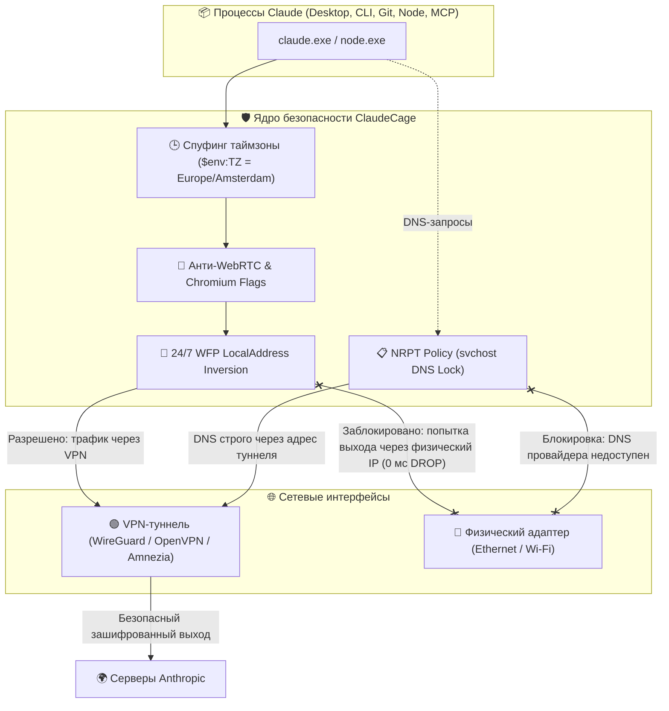

# 🛡️ ClaudeCage: Аппаратный WFP-бункер для Claude на Windows 11

<p align="center">
  
  
  
  
  
  
</p>

Изолированная среда («клетка») для **Claude Desktop (Electron / MSIX)** и **Claude Code (CLI)**. Гарантирует, что Claude работает **строго через VPN-туннель** (AmneziaVPN, WireGuard, OpenVPN, Tailscale), а при любом обрыве или сбое VPN **мгновенно теряет доступ в сеть (0 мс)** без малейшего шанса узнать твой реальный IP-адрес, провайдера или геолокацию.

---

## ☕ 1. Что это и зачем нужно простыми словами

Представь, что Claude живет в **цифровой звуконепроницаемой комнате с бронированной дверью**:

1. **Единственный выход наружу — VPN-туннель.** Claude физически не знает, что у твоего компьютера есть домашний кабель интернета или Wi-Fi.
2. **Идеальная маскировка под европейца:** Claude видит европейский IP-адрес, системное время точки выхода VPN (например, Амстердам `UTC+2`) и английскую локаль.
3. **Железный принцип Fail-Closed:**
   - **VPN включен** → Claude летает на полной скорости.
   - **VPN отключился или залагал** → для Claude интернет **мгновенно умирает на корню**. Он не видит ни твоего настоящего провайдера, ни твоего города. С его точки зрения, на всем компьютере просто выдернули кабель из сети.

### 🏛️ Схема защиты на уровне ядра Windows:



---

## ⚡ 2. Быстрая установка на любой Windows 11 (За 1 минуту)

### Требования:
- **Windows 11** (любая редакция, 64-bit)
- Установленный и запущенный VPN-клиент: **[AmneziaVPN](https://amnezia.org)** (приоритет из коробки) либо любой другой WireGuard / OpenVPN / Tailscale клиент
- Права Администратора на ПК (для первичной настройки WFP)

---

### Вариант А: Установка через PowerShell (Рекомендуемый)

Открой **PowerShell от имени Администратора** и вставь команду:

```powershell
git clone https://github.com/NikitaLozinsky/ClaudeCage_win11.git C:\ClaudeCage
powershell -ExecutionPolicy Bypass -File C:\ClaudeCage\Setup-ClaudeCage.ps1
```

---

### Вариант Б: Без Git (Скачать архивом)

1. Скачай репозиторий ZIP-архивом: [Скачать ZIP](https://github.com/NikitaLozinsky/ClaudeCage_win11/archive/refs/heads/feature/sandbox-scripts.zip).
2. Распакуй архив в папку: **`C:\ClaudeCage`**.
3. Зайди в папку `C:\ClaudeCage` и просто дважды кликни по файлу **`Setup.bat`** (он сам запросит права Администратора).

---

### ⚙️ Что установщик сделает автоматически:
* 📸 **Сделает бэкап системы (Baseline):** сохранит твои текущие настройки реестра, адаптеров и фаервола в локальную папку `backups\baseline\`, чтобы скрипт отката вернул именно твой ПК в исходное состояние.
* 🔒 **Включит защиту от DNS-утечек (NRPT):** запретит системному демону `svchost.exe` опрашивать провайдерский DNS при обрыве VPN.
* 🧱 **Установит 24/7 аппаратный замок WFP:** заблокирует любые попытки выхода Claude через твой домашний IP на уровне ядра Windows.
* 🛡️ **Защита от автообновлений MSIX:** лаунчер сверяет актуальный путь бинарника после обновлений Windows Store; при обновлении запрашивает разовый UAC для обновления правил и не пустит процесс в сеть без защиты.
* 🚀 **Бесшовный ярлык на рабочем столе и в Пуске:** заменяет стандартную иконку на защищенный ярлык `Claude` (с официальным 256px логотипом).
* 💻 **Подключит CLI-хук:** команда `claude` в любом терминале PowerShell сразу станет защищенной.
* 🧪 **Проведет самодиагностику:** прогонит 10 тестов на утечки и выдаст зеленый отчет.

---

## 🕹️ 3. Как пользоваться каждый день

### 🔹 Запуск десктопного приложения Claude Desktop
Кликни по привычной иконке **`Claude`** на рабочем столе или в меню «Пуск».  
*(Лаунчер сам тихо почистит старые процессы в трее, выставит европейскую таймзону и заблокирует утечки WebRTC)*.

### 🔹 Запуск терминального Claude Code (CLI)
В любом окне PowerShell просто введи:
```powershell
claude
```
Команда прозрачно выполняется внутри изолированной клетки.

### 🔹 Мониторинг сокетов в реальном времени (Логгер)
Если хочешь своими глазами наблюдать за сокетами Claude и видеть вердикты ядра WFP:
```powershell
& "C:\ClaudeCage\Watch-ClaudeCage.ps1"
```
- 🟢 `[VERDICT: ALLOWED VIA VPN]` — трафик безопасно идет через туннель.
- 🔴 `[VERDICT: BLOCKED BY WFP DROP]` — пакет на физический IP срезан ядром Windows.
- 🔵 `[VERDICT: LOCAL IPC / MCP]` — внутренний трафик локальных MCP-серверов (`127.0.0.1`).

---

## 🧪 4. Как протестировать защиту (Краш-тест)

1. **Проверка утечек в штатном режиме:**
   ```powershell
   & "C:\ClaudeCage\Test-CageLeaks.ps1" -Detailed
   ```
   *Все 10 тестов должны быть зелеными `[PASS]`, IP — Нидерланды/Европа, провайдерский DNS недоступен.*

2. **Краш-тест на обрыв VPN:**
   - Открой свой VPN-клиент и нажми **«Отключить»**.
   - Попробуй запустить `claude` в консоли или отправить сообщение в Claude Desktop.
   - **Результат:** Приложение не крашится, но соединения нет вообще («No internet connection»). Ни единый пакет не вышел наружу через твой домашний роутер.
   - Включи VPN обратно — связь восстановится автоматически.

---

## 🧩 5. Почему обычный VPN сливает твой IP

| Уязвимость обычного VPN | Как это работает без клетки | Как защищает ClaudeCage |
| :--- | :--- | :--- |
| **Обрыв VPN на лету** | Сокет мгновенно перескакивает на домашний интернет | 🛑 **0 мс Drop** на уровне ядра Windows (LocalAddress Inversion) |
| **DNS-утечки (`svchost.exe`)** | Служба DNS Windows опрашивает домашний DNS провайдера РФ | 🔒 Политика **NRPT** принудительно запирает домены Claude на DNS туннеля |
| **WebRTC IP Leak** | Браузер Chromium сливает домашний `192.168.0.x` через STUN | 🛡️ WebRTC заблокирован на уровне флагов Chromium |
| **Таймзона** | Несовпадение: IP Нидерландов, а время московское (UTC+3) | 🕒 Принудительный спуфинг `$env:TZ = Europe/Amsterdam` |
| **Дочерние утилиты** | `git fetch/push` и MCP-серверы идут мимо VPN | 📦 Бинарники Git (`git-remote-https.exe`, `ssh.exe`) и MCP под замком |
| **MSIX Store Updates** | Обновление меняет путь к бинарнику, снимая старые правила | 🛡️ Лаунчер проверяет регистрацию бинарника и блокирует запуск без правил |

---

## 🔄 6. Полный откат системы (Rollback в 1 клик)

Если тебе понадобится удалить клетку и вернуть систему в исходное состояние, скрипт отката сделает все в один клик:
```powershell
& "C:\ClaudeCage\Rollback-System.ps1"
```
Он удалит правила фаервола `ClaudeKillSwitch`, снимет правила NRPT, восстановит оригинальный реестр из локального бэкапа `backups\baseline\`, вернет старый `$PROFILE` и восстановит IPv6.

---

## 📂 Структура репозитория
```text
C:\ClaudeCage\
├── ARCHITECTURE.md               # Подробная архитектура, Mermaid-диаграмма и разбор слоев защиты
├── CLAUDECAGE_EXPLAINED.md       # Понятное человеческое объяснение концепций и устройства
├── Setup.bat                     # 1-Click установщик для запуска двойным кликом
├── Setup-ClaudeCage.ps1          # Главный оркестратор автоматической установки
├── Start-ClaudeDesktop.ps1       # Безопасный лаунчер Claude Desktop с антифрод-флагами и MSIX-контролем
├── Invoke-ClaudeCLI.ps1          # Безопасный лаунчер Claude Code (подключен в $PROFILE)
├── Sync-ClaudeFirewall.ps1       # Ядро WFP Kill Switch (24/7 LocalAddress Inversion, Make-Before-Break)
├── Set-DnsHardening.ps1          # Настройка NRPT (svchost lock), SMHNR и Location Guard
├── Watch-ClaudeCage.ps1          # Монитор-логгер сокетов реального времени
├── Test-CageLeaks.ps1            # Тестовый аудит на 9 проверок безопасности
├── Rollback-System.ps1           # Полный возврат системы к исходному состоянию
├── bin\                          # Изолированные бинарники node.exe и curl.exe
└── backups\                      # Локальные снапшоты системы для безопасного отката (не пушатся в git)
```

---

<p align="center">
  <b>Разработано для безопасной и анонимной работы с Anthropic Claude на Windows 11.</b>
</p>
