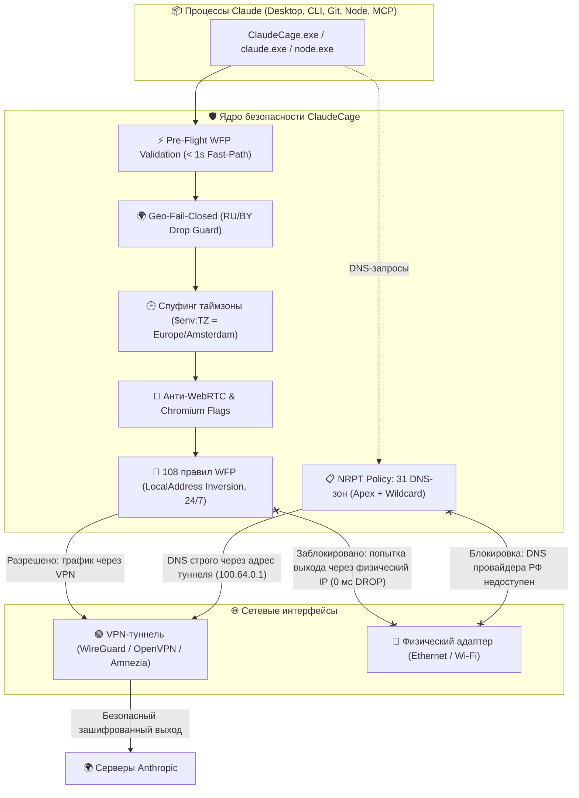

# 🛡️ ClaudeCage: Аппаратный WFP-бункер для Claude на Windows 11

<p align="center">
  
  
  
  
  
  
  
  
</p>

Изолированная среда («клетка») и нативный статический лаунчер для **Claude Desktop (Electron / MSIX)** и **Claude Code (CLI)**. Гарантирует, что Claude работает **строго через VPN-туннель** (AmneziaVPN, WireGuard, OpenVPN, Tailscale), а при любом обрыве или сбое VPN **мгновенно теряет доступ в сеть (0 мс)** без малейшего шанса узнать твой реальный IP-адрес, провайдера или геолокацию.

---

## ☕ 1. Что это и зачем нужно простыми словами

Представь, что Claude живет в **цифровой звуконепроницаемой комнате с бронированной дверью**:

1. **Единственный выход наружу — VPN-туннель.** Claude физически не знает, что у твоего компьютера есть домашний кабель интернета или Wi-Fi.
2. **Идеальная маскировка под европейца:** Claude видит европейский IP-адрес, системное время точки выхода VPN (например, Амстердам `UTC+2`), английскую локаль и скрытые локальные IP-адреса.
3. **Geo-Fail-Closed защита:** Если VPN случайно маршрутизирует трафик через РФ или Беларусь, запуск немедленно блокируется ядром клетки еще до старта процесса Claude, предотвращая бан аккаунта.
4. **Когнитивная маскировка от автономных ИИ-агентов:** При запуске через ярлык рабочий каталог процесса устанавливается в `%USERPROFILE%` (`C:\Users\username`). Если агент выполнит `process.cwd()` или `pwd`, он увидит обычную домашнюю папку и не обнаружит саму клетку.
5. **Железный принцип Fail-Closed:**
   - **VPN включен** → Claude летает на полной скорости.
   - **VPN отключился или залагал** → для Claude интернет **мгновенно умирает на корню**. На уровне ядра Windows Filtering Platform (WFP) пакеты срезаются со скоростью 0 мс. Ни единый байт не покидает компьютер через физический Ethernet или Wi-Fi.

### 🏛️ Схема защиты на уровне ядра Windows:



---

## ⚡ 2. Быстрая установка на любой Windows 11

### Требования:
- **Windows 11** (любая редакция, 64-bit)
- Установленный и запущенный VPN-клиент: **[AmneziaVPN](https://amnezia.org)** (приоритет из коробки) либо любой другой WireGuard / OpenVPN / Tailscale клиент
- Права Администратора на ПК (для первичной регистрации правил WFP)

---

### Вариант А: Использование готового `.exe` файла из GitHub Releases (Самый простой)

1. Перейди в раздел **[GitHub Releases](https://github.com/NikitaLozinsky/ClaudeCage_win11/releases)**.
2. Скачай скомпилированный бинарник **`ClaudeCage.exe`** в папку `C:\ClaudeCage\ClaudeCage.exe`.
3. Открой PowerShell от имени Администратора и примени правила WFP:
   ```powershell
   & "C:\ClaudeCage\ClaudeCage.exe" sync
   ```
4. Запусти приложение двойным кликом по `ClaudeCage.exe` (или через ярлык на Рабочем столе).

---

### Вариант Б: Установка из репозитория через PowerShell

Открой **PowerShell от имени Администратора** и выполни:

```powershell
git clone https://github.com/NikitaLozinsky/ClaudeCage_win11.git C:\ClaudeCage
powershell -ExecutionPolicy Bypass -File C:\ClaudeCage\Setup-ClaudeCage.ps1
```

---

### Вариант В: Сборка нативного бинарника из исходного кода

Если на компьютере установлен компилятор **Go 1.24+**:

```powershell
cd C:\ClaudeCage
powershell -ExecutionPolicy Bypass -File .\Build-ClaudeCage.ps1
```
Скрипт автоматически инкрементирует версию, впечет кастомную 256px иконку через `rsrc`, выполнит стриппинг символов (`-s -w`), сохранит копию в каталог `builds/v<version>/` и переключит системные ярлыки на свежий бинарник.

---

### ⚙️ Что установщик настраивает на компьютере:
* 📸 **Снапшот системы (Baseline):** сохраняет твои текущие настройки реестра, адаптеров и фаервола в локальную папку `backups\baseline\`, чтобы скрипт отката вернул ПК в исходное состояние.
* 🔒 **Защита от DNS-утечек (NRPT):** регистрирует 31 доменную зону (включая apex-домены `claude.ai`, `anthropic.com` и wildcard `*.claude.ai`, Cloudflare, Google Fonts, OCSP/CRL), привязывая системную службу `svchost.exe (Dnscache)` строго к DNS туннеля.
* 🧱 **108 правил WFP (Make-Before-Break):** блокирует любые попытки выхода Claude через твой домашний IP на уровне ядра Windows.
* 🛡️ **Защита от автообновлений Windows Store:** лаунчер динамически отслеживает новые версии MSIX и автоматически защищает их.
* 🚀 **Бесшовный ярлык на рабочем столе и в Пуске:** заменяет стандартную иконку на защищенный ярлык `Claude` с рабочей директорией в `%USERPROFILE%`.
* 💻 **Подключение CLI-хука:** команда `claude` в любом терминале PowerShell сразу работает внутри клетки.
* 🧪 **Самодиагностика:** прогоняет 10 глубоких тестов на утечки и выдает зеленый отчет.

---

## 🕹️ 3. Как пользоваться каждый день

### 🔹 Запуск десктопного приложения Claude Desktop
* Двойной клик по иконке **`Claude`** на рабочем столе или в меню «Пуск».
* Либо прямой запуск из терминала:
  ```powershell
  ClaudeCage.exe
  ```

### 🔹 Запуск терминального Claude Code (CLI)
В любом терминале PowerShell:
```powershell
claude
```
Либо напрямую:
```powershell
ClaudeCage.exe cli [аргументы...]
```

### 🔹 Команды нативного ядра `ClaudeCage.exe`

| Команда | Описание |
| :--- | :--- |
| `ClaudeCage.exe` | Защищенный запуск Claude Desktop (GUI) |
| `ClaudeCage.exe cli [args]` | Запуск Claude Code CLI с пробросом флагов |
| `ClaudeCage.exe sync` | Синхронизация 108 правил WFP Kill Switch |
| `ClaudeCage.exe watch` | Мониторинг сетевых сокетов и сбросов в реальном времени |
| `ClaudeCage.exe test` | Полный запуск 10 верификационных тестов на утечки |
| `ClaudeCage.exe version` | Вывод скомпилированной версии, даты сборки и коммита |

---

## 🧪 4. Как протестировать защиту (Краш-тест)

1. **Проверка утечек в штатном режиме:**
   ```powershell
   ClaudeCage.exe test
   ```
   *Все 10 тестов зеленые `[PASS]`, IP — Европа (Нидерланды), провайдерский DNS недоступен.*

2. **Краш-тест на обрыв VPN:**
   - Открой свой VPN-клиент и нажми **«Отключить»**.
   - Попробуй запустить `claude` в консоли или отправить сообщение в Claude Desktop.
   - **Результат:** Соединение мгновенно обрывается («No internet connection»). Ни единый пакет не вышел наружу через твой домашний роутер.
   - Включи VPN обратно — связь восстановится автоматически.

---

## 🧩 5. Почему обычный VPN сливает твой IP

| Уязвимость обычного VPN | Как это работает без клетки | Как защищает ClaudeCage |
| :--- | :--- | :--- |
| **Обрыв VPN на лету** | Сокет мгновенно перескакивает на домашний интернет | 🛑 **0 мс Drop** на уровне ядра Windows (LocalAddress Inversion) |
| **DNS-утечки (`svchost.exe`)** | Служба DNS Windows опрашивает домашний DNS провайдера РФ | 🔒 Политика **NRPT** принудительно запирает 31 зону на DNS туннеля |
| **WebRTC IP Leak** | Chromium сливает домашний `192.168.0.x` через STUN | 🛡️ WebRTC локальные IP скрыты за mDNS; non-proxied UDP отключен |
| **Таймзона и геолокация** | Несовпадение: IP Нидерландов, а время московское (UTC+3) | 🕒 Принудительный спуфинг `$env:TZ` под таймзону точки выхода |
| **Geo-Ban при сбое туннеля** | VPN упал на резервную российскую ноду | 🚨 **Geo-Fail-Closed** мгновенно блокирует запуск при обнаружении РФ/РБ |
| **Утечка пути ИИ-агенту** | Агент видит `C:\ClaudeCage` через `process.cwd()` | 📁 Ярлыки запускают процесс с `WorkingDirectory = %USERPROFILE%` |
| **Дочерние утилиты** | `git fetch/push` и MCP-серверы идут мимо VPN | 📦 Бинарники Git (`git-remote-https.exe`, `ssh.exe`) и MCP под замком |
| **MSIX Store Updates** | Обновление меняет путь к бинарнику, снимая старые правила | 🛡️ Лаунчер проверяет регистрацию бинарника и блокирует запуск без правил |

---

## 🔄 6. Полный откат системы (Rollback в 1 клик)

Если понадобится полностью удалить клетку и вернуть систему в исходное состояние:
```powershell
& "C:\ClaudeCage\Rollback-System.ps1"
```
Скрипт удалит правила фаервола `ClaudeKillSwitch`, снимет правила NRPT, восстановит оригинальный реестр из локального бэкапа `backups\baseline\`, вернет старый `$PROFILE` и восстановит IPv6.

---

## 📂 Структура репозитория
```text
C:\ClaudeCage\
├── src/                          # Исходный код нативного монолита на Go 1.24
│   ├── main.go                   # Логика ядра, Fast-Path WFP, Geo-Fail-Closed, лаунчер
│   └── go.mod                    # Манифест модуля Go
├── builds/                       # Реестр версионированных бинарных релизов
│   ├── manifest.json             # История сборок, даты и SHA-256 хеши
│   └── v6.3.3/checksums.sha256   # Контрольные суммы релиза
├── icons/                        # Ресурсы и официальные 256px иконки
│   ├── ClaudeCage.ico            # Запекаемая в PE-бинарник иконка
│   └── ClaudeCage.png
├── Build-ClaudeCage.ps1          # Автоматизированный конвейер сборки и версионирования
├── build.bat                     # 1-Click запуск сборки двойным кликом
├── Setup-ClaudeCage.ps1          # Главный оркестратор автоматической установки
├── Setup.bat                     # 1-Click установщик двойным кликом
├── Sync-ClaudeFirewall.ps1       # Ядро WFP Kill Switch (108 правил, Make-Before-Break)
├── Set-DnsHardening.ps1          # Настройка NRPT (31 зона), SMHNR и Location Guard
├── Watch-ClaudeNetworkView.ps1   # Монитор-логгер сокетов реального времени
├── Test-CageLeaks.ps1            # Тестовый аудит на 10 проверок безопасности
├── Rollback-System.ps1           # Полный возврат системы к исходному состоянию
├── bin/                          # Изолированные бинарники node.exe и curl.exe
├── GEMINI_ARGON4_V6.3_DOSSIER.md # Полное экспертное досье низкоуровневой архитектуры
└── backups/                      # Локальные снапшоты системы для безопасного отката
```

---

<p align="center">
  <b>Разработано для безопасной и анонимной работы с Anthropic Claude на Windows 11.</b>
</p>
